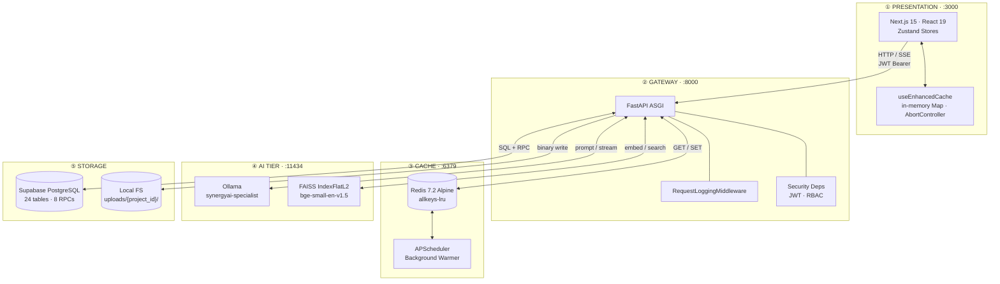
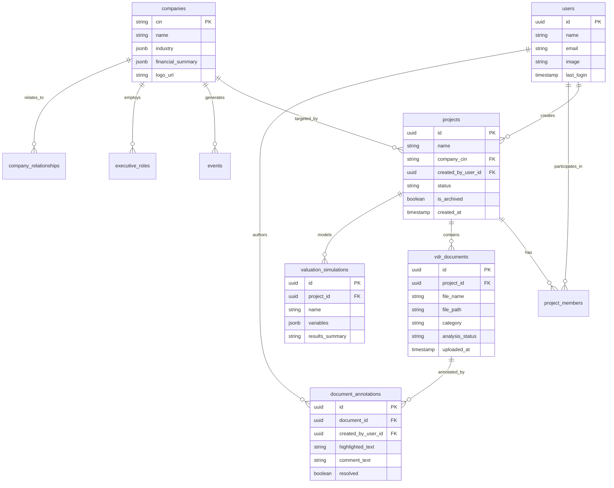

<!-- ═══════════════════════════════════════════════════════════════════════════
     SYNERGYAI · README
     Enterprise M&A Deal Sourcing · Diligence Automation · Financial Intelligence
     ═══════════════════════════════════════════════════════════════════════════ -->

<div align="center">


# ⚡ SYNERGY<span style="color:#009688">AI</span>

### Enterprise M&A Intelligence Platform

<sub>Deal Sourcing · Diligence Automation · Quantitative Valuation · Local LLM Inference</sub>

<br>

[](https://nextjs.org/)
[](https://fastapi.tiangolo.com/)
[](https://www.python.org/)
[](https://www.typescriptlang.org/)

[](https://supabase.com/)
[](https://redis.io/)
[](https://ollama.ai/)
[](https://github.com/facebookresearch/faiss)

<br>

<kbd>[ Overview ](#mission-brief)</kbd> · <kbd>[ Features ](#capabilities)</kbd> · <kbd>[ Architecture ](#blueprint)</kbd> · <kbd>[ Stack ](#spec-sheet)</kbd> · <kbd>[ Setup ](#runbook)</kbd> · <kbd>[ API ](#api-surface)</kbd> · <kbd>[ Security ](#threat-model)</kbd>

</div>

---

> ### 📡 MISSION BRIEFING
>
> **SynergyAI** is an institutional-grade Mergers & Acquisitions platform. It automates the three most expensive bottlenecks in an investment bank's deal pipeline — **sourcing**, **diligence**, and **valuation** — without ever sending a single byte of confidential data to a cloud LLM.
>
> **Threat model:** unannounced, price-sensitive transactions under NDA.
> **Constraint:** zero data exfiltration tolerance.
> **Solution:** local fine-tuned LLaMA-3.1-8B + FAISS + Redis "Hover-to-Predict" caching.

---

## 🎯 Mission Brief

Every M&A analyst does three things on repeat:

```
   ┌─ 1 ─────────────────┐   ┌─ 2 ─────────────────┐   ┌─ 3 ─────────────────┐
   │  SOURCE             │   │  DILIGENCE          │   │  VALUE              │
   │  find the target    │ → │  read 1000s pages   │ → │  model & synthesize │
   │  score the fit      │   │  extract risk       │   │  write the memo     │
   └─────────────────────┘   └─────────────────────┘   └─────────────────────┘
        weeks of work            weeks of work            weeks of work
```

**SynergyAI collapses all three into a single workspace.**

| Bottleneck | Traditional | SynergyAI |
|:---|:---|:---|
| **Target screening** | Manual research, spreadsheets | Natural-language mandate → SSE-streamed fit scores |
| **Due diligence** | Read 1000s of pages | RAG-scoped Q&A with source citations |
| **Risk scoring** | Subjective, siloed | AI-synthesized profiles grounded in VDR |
| **Valuation** | Excel DCFs, error-prone | 10,000-iteration Monte Carlo in milliseconds |
| **Memo writing** | 2–3 analyst days | 6 parallel LLM streams → PDF in ~90s |
| **Data privacy** | ⚠️ Cloud LLM exfiltration risk | ✅ 100% local inference (`localhost:11434`) |

---

## 🚀 Capabilities

### 01 · Strategic Deal Sourcing

```
┌──────────────────────────────────────────────────────────────────────┐
│  INPUT    "Profitable IT services companies · revenue > 100 Cr ·    │
│           Maharashtra · low promoter concentration"                  │
├──────────────────────────────────────────────────────────────────────┤
│  PARSE    → { industry: "IT Services", min_revenue: 1000000000,     │
│               state: "Maharashtra", ... }                           │
├──────────────────────────────────────────────────────────────────────┤
│  MATCH    Corporate filings → candidate shortlist                    │
├──────────────────────────────────────────────────────────────────────┤
│  SCORE    LLM evaluates each candidate · SSE-streamed rationale     │
├──────────────────────────────────────────────────────────────────────┤
│  OUTPUT   Ranked targets with fit scores (0–100) + rationale        │
└──────────────────────────────────────────────────────────────────────┘
```

- **Natural-language mandate parsing** — regex-based structured filter extraction
- **Server-Sent Events** — no head-of-line blocking; scoring streams live
- **Watchlist management** — PostgreSQL-backed target organization

---

### 02 · Virtual Data Room + Document Intelligence

> **Scope guarantee:** every retrieval is filtered by `allowed_sources` at the FAISS query layer — a document uploaded to Deal A cannot surface in Deal B's Q&A, even if it's semantically identical.

| Capability | Implementation |
|:---|:---|
| **Ingestion** | `.pdf` (PyMuPDF `fitz`) · `.docx` (python-docx) · `.txt` |
| **Chunking** | 400-word sliding windows · 50-word overlap |
| **Embedding** | `BAAI/bge-small-en-v1.5` · 384-dim · CUDA/CPU |
| **Index** | FAISS `IndexFlatL2` · thread-safe locks |
| **Retrieval** | Project-scoped top-K, post-filtered by `allowed_sources` |
| **Q&A** | RAG-grounded answers with inline source citations |
| **Annotations** | Coordinate-based PDF highlights · threaded comments · resolve state |

---

### 03 · One-Click Investment Memo

Six independent prompt streams fire concurrently via `asyncio.gather()`:

```
                    ┌──────────────────────────┐
                    │  Mission Control Data    │
                    │  (metrics + risk + syn)  │
                    └────────────┬─────────────┘
                                 │
          ┌──────────────────────┼──────────────────────┐
          │                      │                      │
     ┌────▼────┐            ┌────▼────┐           ┌────▼────┐
     │ Prompt  │            │ Prompt  │    ...    │ Prompt  │
     │  Exec   │            │  Valn   │           │  Recs   │
     │  Summ   │            │  DCF    │           │         │
     └────┬────┘            └────┬────┘           └────┬────┘
          │                      │                      │
          └──────────────────────┼──────────────────────┘
                                 │
                    ┌────────────▼─────────────┐
                    │  Fallback Cascade        │
                    │  (if any stream fails,   │
                    │   rule-based template    │
                    │   replaces it silently)  │
                    └────────────┬─────────────┘
                                 │
                    ┌────────────▼─────────────┐
                    │  ReportLab PDF Compile   │
                    └──────────────────────────┘
```

**Six sections, generated in parallel:**

| # | Section | Source |
|:-:|:---|:---|
| 1 | Executive Summary & Deal Thesis | Mission Control + Risk |
| 2 | Valuation (DCF + Trading Multiples) | Financials + Market |
| 3 | Synergy Potential Breakdown | Synergy Score |
| 4 | Comprehensive Risk Profile | Risk Profile + VDR |
| 5 | Strategic Fit Assessment | Sourcing Criteria |
| 6 | Committee Recommendations | Aggregate Signal |

---

### 04 · Quantitative Valuation

Vectorized NumPy Monte Carlo — **10,000 iterations in milliseconds**, not seconds.

```
                    Random Variables
                    ─────────────────
       ┌─────────────────────────────────────┐
       │  Revenue Growth   ~ N(μ_r, σ_r)     │
       │  EBITDA Margin    ~ N(μ_m, σ_m)     │
       │  WACC             ~ N(μ_w, σ_w)     │
       └────────────────┬────────────────────┘
                        │
                        ▼
       ┌─────────────────────────────────────┐
       │  10,000 × DCF Vectorized Evaluation │
       │  (NumPy broadcasting — no Python   │
       │   loops, no per-iteration overhead)│
       └────────────────┬────────────────────┘
                        │
                        ▼
       ┌─────────────────────────────────────┐
       │  Statistical Distribution           │
       │  Mean · Median · StdDev             │
       │  P5 (downside) · P95 (upside)       │
       └────────────────┬────────────────────┘
                        │
                        ▼
       ┌─────────────────────────────────────┐
       │  LLM Qualitative Synthesis          │
       │  (professional committee commentary)│
       └─────────────────────────────────────┘
```

---

### 05 · Corporate Knowledge Graph

ECharts force-directed network over normalized PostgreSQL relationships:

- **Parent ↔ Subsidiary** ownership chains
- **Joint ventures** and strategic alliances
- **Market competitors** (sector + size proximity)
- **Executive DIN mapping** — uncover interlocking directorates & conflicts of interest

---

### 06 · Hover-to-Predict Cache Layer

> **The core insight:** user intent is knowable before the click.
> `onMouseEnter` fires ~800ms–2s before `onClick` — enough time to warm the entire project's AI cache.

```
   ┌─────────────────┐                        ┌─────────────────┐
   │  Hover Card     │──── onMouseEnter ────▶ │  /prefetch      │
   └─────────────────┘                        └────────┬────────┘
                                                       │
                                                       ▼
                          ┌────────────────────────────────────────┐
                          │  Background Warm Cascade               │
                          │                                        │
                          │  Critical (5s timeout)                 │
                          │    · Risk Profile    → Ollama → Redis  │
                          │    · Synergy Score   → Ollama → Redis  │
                          │    · AI Summary      → Ollama → Redis  │
                          │                                        │
                          │  Non-critical (async, no timeout)      │
                          │    · Team · VDR · Alerts · Tasks       │
                          │    · Intelligence · Sim · Scenarios    │
                          │    · Access Summary · Annotations      │
                          └──────────────────┬─────────────────────┘
                                             │
                                             ▼
   ┌─────────────────┐                        ┌─────────────────┐
   │  Click          │──── instant (< 50ms) ─▶│  Redis HIT      │
   └─────────────────┘                        └─────────────────┘
```

**Dynamic TTL scaling:**

| Cache Class | Base TTL | Peak-Hour TTL<br/><sub>(09:00–17:00 IST)</sub> |
|:---|:---:|:---:|
| `ai_heavy` (memos, narrative) | 1800s | 900s |
| `ai_light` (scores, risk) | 900s | 450s |
| `static` (options, enums) | 3600s | 1800s |
| `market` (indices, quotes) | 180s | 90s |
| `user` (profile, prefs) | 600s | 300s |
| `project` (metrics) | 600s | 300s |
| `documents` (VDR lists) | 300s | 150s |

**Background warmers** — APScheduler refreshes active-user caches every **2 / 3 / 5 / 10 / 15 minutes** based on access pattern.

---

## 🏗️ Blueprint



### ① Latency Masking Hierarchy

```
  Request lifecycle, worst-case cold path:

  Client Map  →  Redis  →  Ollama  →  Fallback Template
     ~0ms        15ms      15–30s          <1ms
     │           │          │              │
     ▼           ▼          ▼              ▼
   HIT ──────▶ HIT ──────▶ HIT ────────▶ ALWAYS RETURNS
```

Every AI endpoint is guarded by a **three-tier fallback**: cache → LLM → deterministic rule-based template. A user never sees a 500 page because Ollama crashed.

### ② Strict Project Isolation

FAISS maintains one global in-memory index across all uploaded documents — but every query is scoped:

```python
allowed_filenames = fetch_doc_names(project_id)          # Supabase
chunks = faiss.search(query, k=5, allowed_sources=allowed_filenames)
#                                          ▲
#                                          └── post-filter at retrieval layer
```

Even if two projects contain byte-identical PDFs, retrieval cannot cross the project boundary.

### ③ Resilient Failure Cascades

| Failure | User-Visible Effect |
|:---|:---|
| Redis down | Latency ↑ · functionality unchanged |
| Ollama OOM | Rule-based analysis served · session intact |
| Supabase read timeout | Retry chain · degraded but functional |
| FAISS index cold | Empty context · LLM instructed to say "no context" |

---

## 📐 Spec Sheet

<table>
<tr>
<td width="50%" valign="top">

#### Frontend
| Component | Version |
|:---|:---|
| Next.js (App Router) | `15.5.2` |
| React | `19.1.0` |
| Tailwind CSS | `3.4.17` |
| TypeScript | `5.0` |
| Zustand | `5.0.8` |
| ECharts (`echarts-for-react`) | `3.0.2` |
| Radix UI | *latest* |
| Lucide Icons | *latest* |

</td>
<td width="50%" valign="top">

#### Backend
| Component | Version |
|:---|:---|
| FastAPI | `>=0.104.0` |
| Uvicorn | `>=0.23.0` |
| Supabase Python | `>=2.0.0` |
| APScheduler | `>=3.10.0` |
| PyMuPDF | `1.23.0` |
| python-docx | `1.0.0` |
| yfinance | `>=0.2.30` |
| ReportLab | *latest* |

</td>
</tr>
<tr>
<td width="50%" valign="top">

#### AI / Vector
| Component | Version |
|:---|:---|
| Ollama | Native service |
| Model | `synergyai-specialist`<br/><sub>(LLaMA-3.1-8B + LoRA)</sub> |
| SentenceTransformers | `>=2.2.0` |
| Embedding model | `BAAI/bge-small-en-v1.5` |
| Embedding dim | `384` |
| FAISS | `>=1.7.4` (`IndexFlatL2`) |

</td>
<td width="50%" valign="top">

#### Infrastructure
| Component | Version |
|:---|:---|
| Redis | `7.2-alpine` |
| Redis eviction | `allkeys-lru` |
| Docker Compose spec | `3.8` |
| PostgreSQL | *Supabase-managed* |
| Python runtime | `3.10` / `3.11` |
| Node runtime | `18.18+` / `20.x` |

</td>
</tr>
</table>

---

## 📂 Repository Layout

```
SynergyAI/
│
├── ⚙️  docker-compose.yml               Redis 7.2 + RedisInsight
├── 📦 package.json                      Next.js 15 · React 19 · Tailwind
├── 🔧 tsconfig.json                     TypeScript compiler options
├── 🎨 tailwind.config.js                Design system
├── 🔒 .env.example                      Frontend env template
│
├── 📁 backend/                          ── Python FastAPI service ──
│   ├── 🚪 main.py                       ASGI entry (from app.main import app)
│   ├── 📄 requirements.txt
│   ├── 🔒 .env.example
│   ├── 🧠 rag_pipeline.py               PyMuPDF · SentenceTransformers · FAISS
│   ├── 💾 synergyai_index.faiss         Serialized vector index
│   ├── 🗺️  synergyai_text_map.pkl        Chunk metadata
│   ├── 📤 uploads/                      Per-project VDR storage
│   │
│   └── 📁 app/
│       ├── main.py                      App init · CORS · schedulers
│       │
│       ├── 📁 core/                     Infrastructure layer
│       │   ├── config.py                Supabase + Ollama settings
│       │   ├── security.py              JWT verification · RBAC DI
│       │   ├── redis_cache.py           Async Redis wrapper
│       │   ├── cache_decorator.py       @cached · dynamic TTL
│       │   ├── cache_warmer.py          APScheduler workers
│       │   ├── ai_batching.py           Parallel LLM queue
│       │   └── streaming_cache.py       SSE response cache
│       │
│       ├── 📁 routers/                  HTTP controllers
│       │   ├── auth.py                  /api/auth
│       │   ├── projects.py              projects · team · tasks · drafts
│       │   ├── ai.py                    sourcing · memos · sims · risk · synergy
│       │   ├── vdr.py                   Virtual Data Room · annotations
│       │   └── knowledge.py             Global knowledge library
│       │
│       └── 📁 services/                 Business logic
│           ├── market.py                yfinance · Nifty / Sensex / USDINR / VIX
│           ├── news.py                  NewsAPI · M&A relevance scoring
│           └── prompt_templates.py      Prompts + fallback generators
│
├── 📁 docs/
│   └── SYSTEM_ARCHITECTURE.md                  System architecture & design specification
│
├── 📁 public/
│   ├── synergy-logo.png
│   └── favicon.png
│
└── 📁 src/                              ── Next.js 15 frontend ──
    │
    ├── 📁 app/                          App Router pages
    │   ├── layout.tsx                   Root shell · QueryClient
    │   ├── page.tsx                     Landing + auth portal
    │   └── dashboard/
    │       ├── [dealId]/                Mission Control · VDR · Valuation
    │       ├── intelligence/            Market monitoring
    │       ├── sourcing/                NL strategic search
    │       ├── chat/                    Global AI copilot
    │       ├── notes/                   Research journal + AI lab
    │       └── knowledge-library/       Private document repo
    │
    ├── 📁 components/
    │   ├── features/                    VDR · valuation · graph · sourcing
    │   └── ui/                          Radix primitives
    │
    ├── 📁 hooks/
    │   └── useEnhancedCache.ts          In-memory Map + dedup
    │
    ├── 📁 lib/
    │   ├── supabaseClient.ts
    │   ├── middleware.ts                Edge route protection
    │   └── navConfig.ts
    │
    ├── 📁 store/                        Zustand (persisted)
    │   ├── reportStore.ts
    │   ├── versionHistoryStore.ts
    │   └── watchlistStore.ts
    │
    └── 📁 types/
        └── index.ts                     945-line data contract layer
```

---

## ⚡ Pre-Flight Checklist

| ✅ | Requirement | Version |
|:--:|:---|:---|
| ☐ | **Node.js** | `v18.18.0` or `v20.x` (LTS) |
| ☐ | **Python** | `3.10` or `3.11` |
| ☐ | **Docker + Compose** | For local Redis |
| ☐ | **Ollama** | Installed from [ollama.ai](https://ollama.ai/) |
| ☐ | **GPU** *(recommended)* | NVIDIA · 8 GB+ VRAM |
| ☐ | **Supabase project** | PostgreSQL + GoTrue Auth enabled |

> [!NOTE]
> Ollama runs fine on CPU — inference is just 5–15× slower. The fallback cascade keeps the app responsive regardless.

---

## 🛠️ Runbook

### ⣿ Step 1 — Clone

```bash
git clone https://github.com/yash-shende99/SynergyAI.git
cd SynergyAI
```

### ⣿ Step 2 — Redis (Docker)

```bash
docker compose up -d redis
docker compose ps
# → redis   listening on 0.0.0.0:6379
```

### ⣿ Step 3 — Backend

```bash
cd backend
python -m venv venv

# Windows
.\venv\Scripts\Activate.ps1
# macOS / Linux
source venv/bin/activate

pip install -r requirements.txt
cp .env.example .env
# → edit backend/.env with:
#     NEXT_PUBLIC_SUPABASE_URL
#     SUPABASE_SERVICE_ROLE_KEY
```

### ⣿ Step 4 — Local AI (Ollama)

```bash
# Terminal 2
ollama serve

# Terminal 3
ollama run synergyai-specialist
# or fall back to:
# ollama run llama3.1:8b
```

**Windows PowerShell — concurrency tuning:**
```powershell
$env:OLLAMA_NUM_PARALLEL="2"
```

### ⣿ Step 5 — Frontend

```bash
# back to repo root
cd ..

npm install
cp .env.example .env.local
# → edit .env.local with:
#     NEXT_PUBLIC_SUPABASE_URL
#     NEXT_PUBLIC_SUPABASE_ANON_KEY
```

---

## 🔐 Environment Matrix

<table>
<tr>
<td width="50%" valign="top">

### `.env.local` — Frontend

| Variable | Req. | Purpose |
|:---|:--:|:---|
| `NEXT_PUBLIC_SUPABASE_URL` | ✅ | Supabase API gateway |
| `NEXT_PUBLIC_SUPABASE_ANON_KEY` | ✅ | Client-side anonymous key |

</td>
<td width="50%" valign="top">

### `backend/.env` — Backend

| Variable | Req. | Purpose |
|:---|:--:|:---|
| `NEXT_PUBLIC_SUPABASE_URL` | ✅ | Supabase gateway |
| `NEXT_PUBLIC_SUPABASE_ANON_KEY` | ✅ | Token verification |
| `SUPABASE_SERVICE_ROLE_KEY` | ✅ | Server-side privileged queries |
| `REDIS_URL` | ○ | `redis://localhost:6379/0` |
| `ADMIN_KEY` | ○ | Cache warm endpoint auth |
| `NEWSAPI_KEY` | ○ | Live news feed |
| `ALPHA_VANTAGE_KEY` | ○ | Fallback market data |

</td>
</tr>
</table>

> [!WARNING]
> **`SUPABASE_SERVICE_ROLE_KEY` bypasses Row Level Security.** Never ship it to a client bundle. It belongs in `backend/.env` only.

---

## 🚦 Boot Sequence

Launch 4 processes:

<table>
<tr><th width="60">Term</th><th>Command</th><th>Endpoint</th></tr>
<tr>
<td align="center"><b>1</b></td>
<td>

```bash
docker compose up -d redis
```

</td>
<td align="center"><code>:6379</code></td>
</tr>
<tr>
<td align="center"><b>2</b></td>
<td>

```bash
ollama serve
```

</td>
<td align="center"><code>:11434</code></td>
</tr>
<tr>
<td align="center"><b>3</b></td>
<td>

```bash
cd backend
source venv/bin/activate   # or .\venv\Scripts\Activate.ps1
uvicorn app.main:app --reload --port 8000
```

</td>
<td align="center"><a href="http://localhost:8000/docs"><code>:8000/docs</code></a></td>
</tr>
<tr>
<td align="center"><b>4</b></td>
<td>

```bash
# repo root
npm run dev
```

</td>
<td align="center"><a href="http://localhost:3000"><code>:3000</code></a></td>
</tr>
</table>

**Health checks:**

| Service | URL |
|:---|:---|
| FastAPI root | http://localhost:8000 |
| Swagger UI | http://localhost:8000/docs |
| Web app | http://localhost:3000 |

---

## 🧭 Operator Walkthrough

> A first-run scenario, start to finish.

**`[1]`** &nbsp; Open `http://localhost:3000` → register → sign in.
Next.js edge middleware validates the Supabase session cookie → redirects to `/dashboard`.

**`[2]`** &nbsp; Navigate to **Deal Sourcing** (`/dashboard/sourcing`).
Enter a mandate: *"Profitable software targets with revenue > 75 Cr"*. Backend parses filters → streams scored candidates via SSE with live rationale.

**`[3]`** &nbsp; Click **Create Project** on any target.
Backend invokes `create_project_and_add_members` RPC → assigns you **Admin** → initializes workspace.

**`[4]`** &nbsp; Open the deal. Hover the card first.
Frontend fires `/api/projects/{id}/prefetch`. By the time you click, Mission Control metrics, risk scores, synergy values, and AI recommendation (BUY / HOLD / SELL) are already in Redis.

**`[5]`** &nbsp; Navigate to **VDR** (`/dashboard/[dealId]/vdr`).
Upload `.pdf` / `.docx` files. Backend saves binaries to `uploads/{project_id}/` and spawns background RAG ingestion.

**`[6]`** &nbsp; Ask the VDR Chat:
*"What are the change of control or indemnification liabilities?"*
Answer streams back with inline source citations — scoped strictly to this project's documents.

**`[7]`** &nbsp; Open any PDF. Select text → create annotation thread.
Tag as question/risk flag · resolve · discuss with team.

**`[8]`** &nbsp; Open **Valuation** tab.
Adjust Revenue Growth, EBITDA Margin, WACC. Click **Run Simulation** → 10,000 Monte Carlo iterations in ms → distribution (Mean, Median, P5, P95) → AI committee commentary.

**`[9]`** &nbsp; Navigate to **Reports** → **Generate Investment Memo**.
Six parallel prompts fire at Ollama via `asyncio.gather()` → institutional memo compiled → export to PDF.

---

## 📡 API Surface

> **~65 verified REST endpoints across 5 routers.**

<details>
<summary><b>🔑 Authentication &amp; Users</b> — <code>/api/auth</code> · <code>/api/users</code></summary>

<br>

| Method | Endpoint | Purpose |
|:---:|:---|:---|
| `POST` | `/api/auth/signup` | Register via Supabase GoTrue |
| `POST` | `/api/auth/login` | Authenticate → session JWT |
| `GET` | `/api/user/profile` | Authenticated user profile |
| `GET` | `/api/users/me` | Preferences + project affiliations |

</details>

<details>
<summary><b>🗂️ Projects &amp; Team</b> — <code>/api/projects</code></summary>

<br>

| Method | Endpoint | Purpose |
|:---:|:---|:---|
| `GET` | `/api/projects` | List user's projects |
| `POST` | `/api/projects` | Create project (via RPC) |
| `POST` | `/api/projects/{id}/prefetch` | Trigger background cache warming |
| `GET` | `/api/projects/{id}/team` | Collaborators + RBAC roles |
| `POST` | `/api/projects/{id}/team/invite` | Invite member · *Admin only* |
| `DELETE` | `/api/projects/{id}` | Delete project · *Admin only* |

</details>

<details>
<summary><b>🧠 AI · Valuation · Memos</b> — <code>/api/ai</code> · <code>/api/projects/{id}</code></summary>

<br>

| Method | Endpoint | Purpose |
|:---:|:---|:---|
| `POST` | `/api/companies/strategic_search` | LLM-scored targets · **SSE stream** |
| `GET` | `/api/projects/{id}/mission_control` | Compiled metrics + scores + recs |
| `GET` | `/api/projects/{id}/generate_memo` | 6-prompt parallel memo |
| `POST` | `/api/projects/{id}/simulations/run` | 10,000-iter Monte Carlo DCF |
| `GET` | `/api/projects/{id}/knowledge_graph` | Subsidiaries · competitors · execs |
| `GET` | `/api/projects/{id}/risk_profile` | RAG-driven risk synthesis |
| `GET` | `/api/projects/{id}/synergy_score` | Quantitative + strategic synergy |
| `GET` | `/api/intelligence/market` | Live Nifty · Sensex · sectors |

</details>

<details>
<summary><b>📑 Virtual Data Room &amp; Annotations</b> — <code>/api/vdr</code></summary>

<br>

| Method | Endpoint | Purpose |
|:---:|:---|:---|
| `POST` | `/api/vdr/documents/upload` | Upload → background FAISS vectorization |
| `GET` | `/api/projects/{id}/vdr/documents` | List project VDR |
| `POST` | `/api/projects/{id}/vdr/search` | Scoped semantic / keyword search |
| `POST` | `/api/projects/{id}/vdr/qa` | Q&A with citation chips |
| `GET` | `/api/documents/{id}/annotations` | Annotation threads |
| `POST` | `/api/annotations/create` | New highlight + thread |
| `PUT` | `/api/annotations/{id}/resolve` | Toggle resolution |

</details>

---

## 🗄️ Data Model



**Schema notes:**

- **24 tables** · **8 stored procedures (RPCs)** including `create_project_and_add_members`
- **JSONB columns** on `companies.industry`, `companies.financial_summary`, `valuation_simulations.variables` — semi-structured financial data without rigid schema migrations
- **Row Level Security** enforces project-level isolation at the PostgreSQL layer as a last-line defense

---

## 🛡️ Threat Model

<table>
<tr>
<td width="50%" valign="top">

### ✅ Privacy Guarantees

- **Zero cloud data exfiltration.** All inference is `localhost:11434`. Deal materials never leave the perimeter.
- **No hardcoded secrets.** All connection strings loaded via env vars, validated at startup.
- **No telemetry.** No analytics SDKs, no external logging sinks.

</td>
<td width="50%" valign="top">

### ✅ Access Controls

- **JWT verification** on every protected route via `security.py`
- **RBAC** via FastAPI DI: `get_project_member_auth` / `get_project_admin_auth`
- **CORS whitelist** — only `localhost:3000` / `127.0.0.1:3000`
- **Destructive ops** (delete, invite) require `Admin` role

</td>
</tr>
</table>

**Defense in depth — 4 layers:**

```
  ①  Frontend middleware  →  redirect unauthenticated users
  ②  FastAPI Depends()     →  validate JWT, check membership
  ③  Query scoping         →  .eq('project_id', pid) on every read
  ④  PostgreSQL RLS        →  database refuses unauthorized rows
```

---

## 🧪 Verification

```bash
# ESLint
npm run lint

# TypeScript strict (no emit)
npx tsc --noEmit

# Tailwind build config sanity
npm run build:css
```

> [!NOTE]
> Full unit/integration suites are not yet implemented across all routers. Runtime contracts are enforced by **Pydantic** (backend) and **TypeScript strict mode** (frontend, 945-line `types/index.ts`).

---

## 🔧 Troubleshooting

<details>
<summary><b>Redis refused connection</b> — <code>ConnectionRefusedError: [Errno 111]</code></summary>

<br>

**Symptom:** backend logs `⚠️ Redis connection failed` · API latency spikes
**Cause:** Redis container not running on `:6379`
**Fix:**

```bash
docker compose up -d redis
docker compose ps
```

</details>

<details>
<summary><b>Ollama OOM or inference errors</b></summary>

<br>

**Symptom:** memo / sourcing returns fallback templates or HTTP 500
**Cause:** GPU VRAM exhausted, or Ollama daemon stopped
**Fix:**

```bash
ollama serve              # ensure daemon is up
$env:OLLAMA_NUM_PARALLEL="1"   # Windows · reduce concurrency
```

SynergyAI's built-in fallback engine will serve deterministic analyses regardless — no crash.

</details>

<details>
<summary><b>Windows <code>UnicodeEncodeError: 'cp1252'</code></b></summary>

<br>

**Symptom:** FastAPI crashes printing Unicode / emoji to terminal
**Cause:** default CP1252 stdout on Windows
**Fix:** automated in `backend/app/main.py:4-7` — forces UTF-8 buffers. Ensure Python 3.10+.

</details>

<details>
<summary><b>Supabase <code>403 Forbidden</code> on reads</b></summary>

<br>

**Symptom:** project / team endpoints fail
**Cause:** `SUPABASE_SERVICE_ROLE_KEY` missing or wrong (must be **service role**, not anon)
**Fix:** set in `backend/.env` → restart backend

</details>

---

## ⚠️ Known Limits & Roadmap

<table>
<tr>
<td width="50%" valign="top">

### ⚠️ Current Constraints

| Limit | Impact |
|:---|:---|
| **Flat FAISS index** | Post-filter isolation crowds out candidates >50k chunks |
| **Local FS uploads** | `backend/uploads/` blocks multi-node horizontal scale |
| **Sync long-running HTTP** | Memo gen can block up to 120s uncached |
| **No Celery/queue** | Long jobs tie up workers |

</td>
<td width="50%" valign="top">

### 🗺️ Roadmap

- [ ] **pgvector migration** — HNSW indexing inside Supabase, tenant boundaries at query time
- [ ] **Async task queue** — Celery / RQ for memo & sim jobs, WebSocket progress
- [ ] **S3 / R2 object storage** — replace local `uploads/` with encrypted buckets
- [ ] **CI/CD workflows** — GitHub Actions for lint · tests · Docker builds
- [ ] **Test coverage** — pytest + Playwright across routers & UI flows

</td>
</tr>
</table>

---

## 🤝 Contributing

```
  ╭─────────────────────────────────────────────────────╮
  │  Fork  →  Branch  →  Commit  →  Push  →  PR         │
  ╰─────────────────────────────────────────────────────╯
```

```bash
# 1. Fork on GitHub

# 2. Feature branch
git checkout -b feat/your-feature-name

# 3. Conventional Commits
git commit -m "feat(valuation): add discounted payback period metric"

# 4. Push
git push origin feat/your-feature-name

# 5. Open PR against main
```

**Commit convention** — [Conventional Commits](https://www.conventionalcommits.org/):

| Type | Use for |
|:---|:---|
| `feat` | New feature |
| `fix` | Bug fix |
| `docs` | Documentation |
| `chore` | Tooling / deps |
| `refactor` | Internal restructuring |

---

## 📄 Licence

No open-source licence is currently specified. **All rights reserved** by the author.

For commercial licensing, partnership, or usage inquiries → contact the repository maintainer.

---

## 👥 Authors & Credits

<table>
<tr>
<td width="50%" valign="top">

**Creator & Architect**
[**@yash-shende99**](https://github.com/yash-shende99)

**Repository**
[github.com/yash-shende99/SynergyAI](https://github.com/yash-shende99/SynergyAI)

</td>
<td width="50%" valign="top">

**Built with**

[](https://ollama.ai/)
[](https://fastapi.tiangolo.com/)
[](https://nextjs.org/)
[](https://supabase.com/)
[](https://github.com/facebookresearch/faiss)
[](https://sbert.net/)

</td>
</tr>
</table>

---

<div align="center">

<sub>

**SYNERGYAI** · Enterprise M&A Intelligence · Local Inference · Zero Exfiltration

*Built for the deals that can't afford to leak.*

</sub>

</div>

<!-- ═══════════════════════════════════════════════════════════════════════════
     END OF README
     ═══════════════════════════════════════════════════════════════════════════ -->