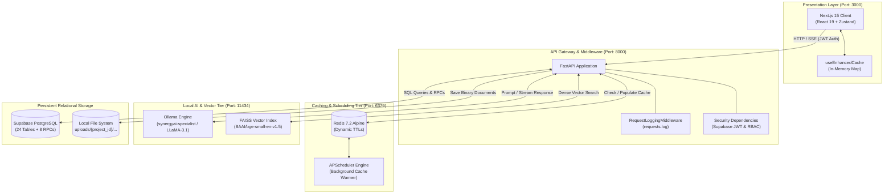
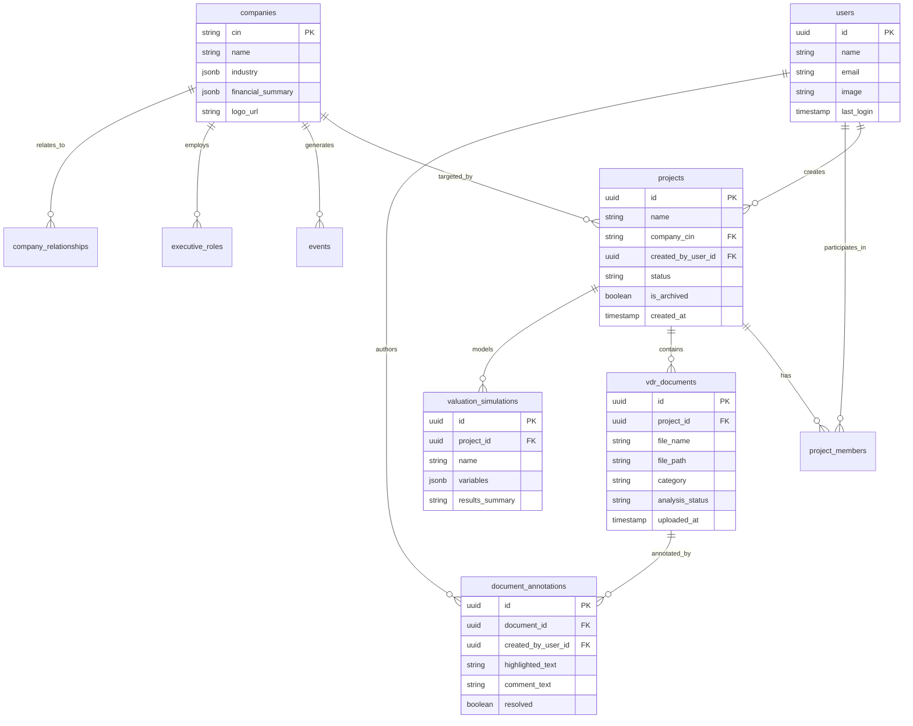

<div align="center">
  

  # ⚡ SynergyAI

  **Enterprise M&A Deal Sourcing, Diligence Automation & Quantitative Financial Intelligence Platform**

  [](https://nextjs.org/)
  [](https://fastapi.tiangolo.com/)
  [](https://www.python.org/)
  [](https://www.typescriptlang.org/)
  [](https://supabase.com/)
  [](https://redis.io/)
  [](https://ollama.ai/)
  [](https://github.com/facebookresearch/faiss)

  <p align="center">
    <a href="#overview">Overview</a> •
    <a href="#key-features">Key Features</a> •
    <a href="#system-architecture">Architecture</a> •
    <a href="#technology-stack">Tech Stack</a> •
    <a href="#installation-and-setup">Installation</a> •
    <a href="#running-the-application">Running</a> •
    <a href="#api-catalog">API Catalog</a> •
    <a href="#security-and-privacy">Security</a>
  </p>
</div>

---

> 📖 **Deep Technical Blueprint Available:** For staff-level architectural walkthroughs, mathematical derivations of valuation algorithms, and interview defense scripts, refer to [`docs/SYSTEM_ARCHITECTURE_AND_INTERVIEW_GUIDE.md`](docs/SYSTEM_ARCHITECTURE_AND_INTERVIEW_GUIDE.md).

---

## 📑 Table of Contents

- [Overview](#overview)
- [Key Features](#key-features)
- [Technology Stack](#technology-stack)
- [System Architecture](#system-architecture)
- [Repository Structure](#repository-structure)
- [Prerequisites](#prerequisites)
- [Installation and Setup](#installation-and-setup)
- [Environment Variables & Configuration](#environment-variables)
- [Running the Application](#running-the-application)
- [Practical User Journey & Walkthrough](#user-journey)
- [API Documentation & Verified Endpoints](#api-catalog)
- [Database Architecture](#database-architecture)
- [Security and Privacy](#security-and-privacy)
- [Code Quality, Linting & Verification](#code-quality)
- [Troubleshooting & FAQ](#troubleshooting)
- [Known Limitations & Roadmap](#known-limitations)
- [Contributing](#contributing)
- [Licence](#licence)
- [Authors & Acknowledgements](#authors)

---

<a id="overview"></a>
## 🌟 Overview

**SynergyAI** is an institutional-grade Mergers & Acquisitions (M&A) platform designed to automate deal origination, streamline confidential due diligence, and synthesize multi-dimensional financial intelligence. 

In traditional investment banking and private equity workflows, analysts spend hundreds of hours manually reviewing thousands of pages of unstructured data—including audited financial statements, legal contracts, executive disclosures, and regulatory filings. Cloud-hosted AI models present severe compliance and data-exfiltration hazards when processing unannounced, price-sensitive corporate transactions under Non-Disclosure Agreements (NDAs).

SynergyAI solves this through a **privacy-first, local-inference architecture** coupled with a high-performance **"Hover-to-Predict" multi-tier caching engine**:
* **100% On-Premise / Local Inference:** Runs fine-tuned large language models (`synergyai-specialist` via Ollama) and dense semantic vector search (`FAISS` + `BAAI/bge-small-en-v1.5`) strictly within the infrastructure boundary.
* **Sub-50ms Latency for Heavy Workloads:** Intercepts user intent at the UI layer (`onMouseEnter`) to trigger asynchronous pre-computation in Redis, turning 15-second parallel LLM generations into instant cache hits upon navigation.
* **Deterministic Reliability:** Implements institutional fallback cascades across all generative pipelines, ensuring the platform remains fully functional even under GPU VRAM constraints or upstream network outages.

---

<a id="key-features"></a>
## 🚀 Key Features

### 🧠 1. Strategic Deal Sourcing & Screening Engine
* **Natural Language Entity Extraction:** Parses unstructured investor mandates (e.g., *"Find profitable IT services companies with revenue > 100 Cr in Maharashtra"*) using server-side regex filter extraction.
* **Real-Time Evaluation Streaming:** Uses FastAPI `StreamingResponse` (`text/event-stream`) to score candidate targets against strategic criteria and stream live evaluation rationale to the client without head-of-line blocking.
* **Watchlist Management:** Allows corporate development teams to organize acquisition targets into custom watchlists backed by PostgreSQL relational constraints.

### 📑 2. Virtual Data Room (VDR) & Document Intelligence
* **Multi-Format Ingestion:** Extracts and standardizes confidential deal rooms from `.pdf` (PyMuPDF `fitz`), `.docx` (python-docx), and `.txt` files with 400-word sliding windows and 50-word overlaps.
* **Project-Scoped Semantic Retrieval:** Scopes semantic similarity search over dense embeddings (`BAAI/bge-small-en-v1.5`) to authorized project team members, preventing cross-deal data leakage.
* **Conversational Diligence Agent:** Contextual paralegal AI assistant that answers complex contract queries with direct citations and excerpts from uploaded data room files.
* **Collaborative PDF Annotations:** Interactive PDF viewer supporting coordinate-based highlights, threaded team discussions, and resolution statuses (`resolved: boolean`).

### 💼 3. One-Click Investment Memo Synthesizer
* **Parallel Generative Orchestration:** Spawns 6 concurrent asynchronous prompt streams via Python's `asyncio.gather()` to generate comprehensive institutional memos covering:
  1. Executive Summary & Deal Thesis
  2. Valuation Methodology (DCF & Trading Multiples)
  3. Synergy Potential Breakdown
  4. Comprehensive Risk Profile
  5. Strategic Fit Assessment
  6. Final Committee Recommendations
* **Institutional Fallback Protection:** Employs rule-based financial analysis templates (`prompt_templates.py`) that seamlessly substitute if local LLM workers throttle, time out, or produce malformed JSON.
* **Automated PDF Compilation:** Generates structured PDF reports ready for investment committee distribution using ReportLab and Client Canvas utilities.

### 📈 4. Quantitative Valuation & Monte Carlo Simulation
* **Vectorized Numerical Modeling:** Executes 10,000-iteration Monte Carlo DCF simulations in milliseconds using vectorized NumPy normal distributions over revenue growth, EBITDA margins, and Weighted Average Cost of Capital (WACC).
* **Statistical Risk Percentiles:** Calculates fundamental valuation metrics including Mean, Median, Standard Deviation, P5 (downside threshold), and P95 (upside threshold).
* **Qualitative AI Synthesis:** Passes simulated percentile distributions to the local LLM to generate professional, data-backed analytical commentary for committee review.

### 🕸️ 5. Corporate Knowledge Graph & Executive DIN Mapping
* **Entity Relationship Networks:** Transforms normalized database relationships into dynamic network graphs using ECharts, mapping parent corporations, operating subsidiaries, joint ventures, and market competitors.
* **Director Identification (DIN) Tracking:** Interlinks board members and key executive officers across corporate entities to uncover hidden conflicts of interest or interlocking directorates.

### ⚡ 6. "Hover-to-Predict" Multi-Tier Caching
* **Intent-Based Prefetching:** Intercepts `onMouseEnter` events on project and pipeline cards, firing prefetch requests that warm Redis caches seconds before the user clicks.
* **Smart TTL Calculation:** Dynamically scales cache lifetimes (180s to 3600s) based on domain complexity (`ai_heavy`, `market`, `user`), automatically cutting TTLs by 50% during peak Indian stock exchange trading hours (09:00–17:00).
* **Automated Cache Warmers:** Integrated `APScheduler` background workers periodically refresh dashboard metrics, market indices, and project intelligence for active platform users.

---

<a id="technology-stack"></a>
## 🛠️ Technology Stack

| Domain | Technology | Verified Version | Purpose & Architecture Rationale |
|---|---|---|---|
| **Frontend Framework** | **Next.js (App Router)** | `15.5.2` | Server Components, client-side routing, and optimized SSR shell rendering. |
| **UI Library & Styling** | **React & Tailwind CSS** | `19.1.0` / `3.4.17` | Utility-first CSS, Radix UI primitives (`@radix-ui`), Lucide icons, responsive dark-mode layouts. |
| **State Management** | **Zustand** | `5.0.8` | Lightweight, decoupled stores (`reportStore`, `versionHistoryStore`, `watchlistStore`) with localStorage persistence. |
| **Client-Side Cache** | **useEnhancedCache** | Custom Hook | In-memory `Map` cache with request deduplication and `AbortController` cancellation. |
| **Data Visualization** | **ECharts & Recharts** | `3.0.2` (echarts-for-react) | High-performance canvas rendering for interactive corporate knowledge graphs and valuation distributions. |
| **Backend Framework** | **FastAPI** | `>=0.104.0` | Asynchronous Python framework with native ASGI concurrency, strict Pydantic schemas, and auto-generated OpenAPI docs. |
| **ASGI Web Server** | **Uvicorn** | `>=0.23.0` | High-throughput asynchronous server supporting WebSockets and HTTP/1.1 pipelines. |
| **Primary Database** | **Supabase (PostgreSQL)** | `>=2.0.0` | Managed PostgreSQL hosting 24 application tables, GoTrue Auth JWTs, and 8 database stored procedures (RPCs). |
| **Distributed Cache** | **Redis** | `7.2-alpine` | Key-value cache with `allkeys-lru` eviction policy and sub-millisecond serialization response times. |
| **Task Scheduling** | **APScheduler** | `>=3.10.0` | In-process background cron scheduler warming active user caches at 2, 3, 5, 10, and 15-minute intervals. |
| **Local LLM Engine** | **Ollama** | Native Service | Localhost inference server hosting fine-tuned `synergyai-specialist` (LLaMA-3.1-8B LoRA adapter). |
| **Dense Vector Embeddings** | **SentenceTransformers** | `>=2.2.0` | Generates 384-dimensional dense vectors using `BAAI/bge-small-en-v1.5` on CUDA/CPU. |
| **Vector Similarity Index**| **FAISS (IndexFlatL2)** | `>=1.7.4` | In-memory Euclidean distance similarity search over document chunks under thread-safe locks. |
| **Document Processing** | **PyMuPDF & python-docx** | `1.23.0` / `1.0.0` | High-speed text extraction and sliding-window chunking from PDF and Word documents. |
| **Market Data Scraper** | **yfinance** | `>=0.2.30` | Live ticker data for Indian stock market indices (NIFTY 50, BSE SENSEX, USD/INR, India VIX). |
| **Containerization** | **Docker & Compose** | `3.8 Spec` | Containerized local orchestration for Redis 7.2 and RedisInsight GUI. |

---

<a id="system-architecture"></a>
## 🏗️ Architecture Overview

The system follows a decoupled, service-oriented architecture designed to isolate heavy mathematical and generative AI tasks from the user-facing web layer:



### Architecture Highlights:
1. **Multi-Tier Latency Masking:** Requests query the client-side `useEnhancedCache` first. On miss, they hit the FastAPI `@cached` layer backed by Redis. Only on a complete cache miss does the system invoke local LLM inference.
2. **Strict Project Isolation:** Even though FAISS maintains an in-memory vector index across documents, search queries require project-level authorization. Candidate vectors are filtered strictly against the document IDs authorized for that project in Supabase.
3. **Resilient Failure Cascades:** If the local LLM encounters an Out-Of-Memory (OOM) exception or Ollama is temporarily stopped, the system catches the error and serves deterministic rule-based analysis without breaking the user session.

---

<a id="repository-structure"></a>
## 📂 Repository Structure

```
SynergyAI/
├── .env.example                         # Safe frontend environment template
├── docker-compose.yml                   # Redis 7.2 & RedisInsight services
├── package.json                         # Next.js 15, React 19, Tailwind dependencies
├── tsconfig.json                        # TypeScript compiler options
├── tailwind.config.js                   # Tailwind CSS styling design system
│
├── backend/                             # Python FastAPI Backend Microservice
│   ├── .env.example                     # Safe backend environment template
│   ├── requirements.txt                 # Python dependencies manifest
│   ├── main.py                          # Root ASGI entry point (from app.main import app)
│   ├── rag_pipeline.py                  # PyMuPDF parser, SentenceTransformers, FAISS RAG
│   ├── synergyai_index.faiss             # Serialized FAISS vector index binary
│   ├── synergyai_text_map.pkl           # Pickled chunk text mapping metadata
│   ├── uploads/                         # Storage directory for uploaded VDR files
│   │
│   └── app/
│       ├── main.py                      # FastAPI app initialization, CORS, schedulers
│       ├── core/                        # Infrastructure, caching, and security
│       │   ├── config.py                # Supabase & Ollama server settings
│       │   ├── security.py              # Supabase JWT & RBAC dependency injection
│       │   ├── redis_cache.py           # Async Redis client wrapper
│       │   ├── cache_decorator.py       # @cached SmartCache with peak-hour dynamic TTL
│       │   ├── cache_warmer.py          # Background task cache warmer for active users
│       │   ├── ai_batching.py           # ThreadPool & batch LLM queue processor
│       │   └── streaming_cache.py       # Token-by-token streaming response cache
│       ├── routers/                     # HTTP API Route Controllers
│       │   ├── auth.py                  # User authentication (/api/auth)
│       │   ├── projects.py              # Projects, team RBAC, tasks, drafts, notifications
│       │   ├── ai.py                    # Sourcing, memos, simulations, risk & synergy scores
│       │   ├── vdr.py                   # Virtual Data Room (VDR) & PDF annotations
│       │   └── knowledge.py             # User-scoped global knowledge library
│       └── services/                    # Business Logic & Integrations
│           ├── market.py                # Yahoo Finance live market feeds & sector trends
│           ├── news.py                  # NewsAPI integration with M&A relevance scoring
│           └── prompt_templates.py      # LLM prompts & institutional fallback generators
│
├── docs/                                # Technical Architecture & Documentation
│   └── SYSTEM_ARCHITECTURE_AND_INTERVIEW_GUIDE.md # 1,000+ line technical architecture & interview guide
│
├── public/                              # Static Assets
│   ├── synergy-logo.png                 # Official SynergyAI Platform Logo
│   └── favicon.png                      # Application browser favicon
│
└── src/                                 # Next.js 15 Frontend (App Router)
    ├── app/                             # Next.js Pages & Layouts
    │   ├── layout.tsx                   # Root HTML shell & QueryClient provider
    │   ├── page.tsx                     # Landing & authentication portal
    │   └── dashboard/                   # Authenticated user dashboard
    │       ├── [dealId]/                # Dynamic project workspaces (Mission Control, VDR, Valuation)
    │       ├── intelligence/            # Live financial news & market monitoring
    │       ├── sourcing/                # Target discovery & natural language strategic search
    │       ├── chat/                    # Global AI copilot chat interface
    │       ├── notes/                   # Research journal & AI analytical lab
    │       └── knowledge-library/       # User-level private document repository
    ├── components/                      # UI Component Tree
    │   ├── features/                    # Domain features (VDR, valuation, graph, sourcing)
    │   └── ui/                          # Radix UI primitives, modals, buttons, forms
    ├── hooks/                           # Custom React Hooks (useEnhancedCache.ts)
    ├── lib/                             # Utility & Client Instances
    │   ├── supabaseClient.ts            # Supabase JS browser client
    │   ├── middleware.ts                # Next.js edge route protection middleware
    │   └── navConfig.ts                 # Sidebar navigation & feature header routing
    ├── store/                           # Zustand Persistent State Stores
    │   ├── reportStore.ts               # Investment memo drafts state
    │   ├── versionHistoryStore.ts       # Document version history state
    │   └── watchlistStore.ts            # Sourcing watchlist state
    └── types/                           # TypeScript Interface Definitions
        └── index.ts                     # Full TypeScript data contracts (945 lines)
```

---

<a id="prerequisites"></a>
## ⚡ Prerequisites

Before installing, ensure your host environment meets the following minimum requirements:

* **Node.js:** `v18.18.0` or `v20.x` (LTS recommended)
* **Python:** `3.10` or `3.11`
* **Docker & Docker Compose:** Required to run the local Redis service
* **Ollama:** Installed locally ([ollama.ai](https://ollama.ai/))
* **GPU Requirements (Optional but Recommended):** NVIDIA GPU with 8GB+ VRAM for local LLaMA-3.1-8B inference. Can run on CPU (slower inference).
* **Supabase Project:** A hosted or local Supabase project with PostgreSQL and GoTrue Auth enabled.

---

<a id="installation-and-setup"></a>
## 📥 Installation and Setup

### 1. Clone the Repository
```bash
git clone https://github.com/yash-shende99/SynergyAI.git
cd SynergyAI
```

### 2. Start the Redis Cache (Docker)
Start the Redis 7.2 container and RedisInsight dashboard using the root Docker Compose file:
```bash
docker compose up -d redis
```
*Verify Redis is healthy:*
```bash
docker compose ps
# Output should show service 'redis' listening on 0.0.0.0:6379
```

### 3. Setup and Start the Python Backend
From the repository root, configure a Python virtual environment and install the verified dependencies:
```bash
cd backend
python -m venv venv

# Activate virtual environment:
# On Windows (PowerShell):
.\venv\Scripts\Activate.ps1
# On macOS / Linux:
source venv/bin/activate

# Install dependencies:
pip install -r requirements.txt

# Configure backend environment:
cp .env.example .env
# Edit backend/.env and populate your NEXT_PUBLIC_SUPABASE_URL and SUPABASE_SERVICE_ROLE_KEY
```

### 4. Setup the Local AI Model (Ollama)
Ensure the Ollama daemon is running and configure the target model:
```bash
# In a new terminal, start the Ollama server:
ollama serve

# Run the base model or specialized fine-tuned adapter:
ollama run synergyai-specialist
# Alternatively, if running the base model:
ollama run llama3.1:8b
```
*(Optional for Windows PowerShell)* Set concurrency:
```powershell
$env:OLLAMA_NUM_PARALLEL="2"
```

### 5. Setup and Configure the Next.js Frontend
From the repository root, install dependencies and set environment keys:
```bash
# Return to root directory
cd ..

# Install Node dependencies
npm install

# Configure frontend environment:
cp .env.example .env.local
# Edit .env.local and populate NEXT_PUBLIC_SUPABASE_URL and NEXT_PUBLIC_SUPABASE_ANON_KEY
```

---

<a id="environment-variables"></a>
## 🔐 Environment Variables & Configuration

### Frontend Configuration (`.env.local`)
| Variable Name | Required | Default / Example | Purpose |
|---|---|---|---|
| `NEXT_PUBLIC_SUPABASE_URL` | **Yes** | `https://your-project.supabase.co` | Supabase project API gateway endpoint. |
| `NEXT_PUBLIC_SUPABASE_ANON_KEY` | **Yes** | `eyJhbGciOi...` | Public client-side anonymous key for Supabase Auth. |

### Backend Configuration (`backend/.env`)
| Variable Name | Required | Default / Example | Purpose |
|---|---|---|---|
| `NEXT_PUBLIC_SUPABASE_URL` | **Yes** | `https://your-project.supabase.co` | Supabase API gateway endpoint. |
| `NEXT_PUBLIC_SUPABASE_ANON_KEY` | **Yes** | `eyJhbGciOi...` | Public client key for token verification. |
| `SUPABASE_SERVICE_ROLE_KEY` | **Yes** | `eyJhbGciOi...` | Privileged service key used for server-side queries. |
| `REDIS_URL` | No | `redis://localhost:6379/0` | Connection string for Redis cache instance. |
| `ADMIN_KEY` | No | `synergy_admin_secure_key_123` | Security key for manual cache warming (`/api/cache/warm/{id}`). |
| `NEWSAPI_KEY` | No | *None (Fallback active)* | Optional NewsAPI.org key for live market news. |
| `ALPHA_VANTAGE_KEY` | No | *None (yfinance active)* | Optional market data key. |

---

<a id="running-the-application"></a>
## 🚀 Running the Application

To run the complete system locally, execute the following commands in separate terminals:

### Terminal 1: Distributed Cache
```bash
docker compose up -d redis
```

### Terminal 2: Local AI Inference
```bash
ollama serve
```

### Terminal 3: FastAPI Backend
```bash
cd backend
# Windows:
.\venv\Scripts\Activate.ps1
# Linux/macOS:
source venv/bin/activate

uvicorn app.main:app --reload --port 8000
```
* Health check: [http://localhost:8000/](http://localhost:8000/)  
* Interactive Swagger Docs: [http://localhost:8000/docs](http://localhost:8000/docs)

### Terminal 4: Next.js Frontend
```bash
# In the repository root
npm run dev
```
* Web Application: [http://localhost:3000](http://localhost:3000)

---

<a id="user-journey"></a>
## 📖 Practical User Journey & Walkthrough

1. **Authentication:** Open [http://localhost:3000](http://localhost:3000). Create an account or sign in. Next.js edge middleware (`src/lib/middleware.ts`) validates the Supabase session cookie and redirects authenticated users to `/dashboard`.
2. **Deal Sourcing & Strategic Matching:** Navigate to **Deal Sourcing** (`/dashboard/sourcing`). Enter an acquisition thesis in natural language (e.g., *"Profitable software targets with revenue > 75 Cr"*). The backend parses filters, searches corporate filings, and streams live evaluations with strategic fit scores (0–100) via Server-Sent Events.
3. **Project Origination:** Click *"Create Project"* from any target company. The platform executes the `create_project_and_add_members` stored procedure in Supabase, assigning you the **Admin** role and initializing the deal workspace.
4. **Mission Control Dashboard:** Open the newly created deal. As you hover over the card, the frontend pings `/api/projects/{id}/prefetch`. When opened, Mission Control displays real-time health metrics, synergy values, risk levels, and AI recommendations (BUY / HOLD / SELL).
5. **Virtual Data Room (VDR) & Diligence:** Navigate to the **Project VDR** tab (`/dashboard/[dealId]/vdr`). Upload confidential documents (`.pdf`, `.docx`). The backend stores the file in `uploads/{project_id}/` and launches an asynchronous background task to extract, chunk, and index embeddings in FAISS.
6. **Scoped Paralegal Q&A:** Use the interactive VDR Chat to ask questions (e.g., *"What are the change of control or indemnification liabilities?"*). The system retrieves the top relevant excerpts strictly from the project's documents and synthesizes an answer with direct source citations.
7. **Document Annotations:** Open any PDF document in the viewer. Select text to create an annotation thread. Tag comments as questions or risk flags and track resolution status with team members.
8. **Quantitative Valuation & Monte Carlo:** Open the **Valuation** tab. Adjust assumptions for Revenue Growth, EBITDA Margins, and Cost of Capital (WACC). Click *"Run Simulation"* to execute 10,000 randomized Monte Carlo iterations. Review the resulting statistical distribution (Mean, Median, P5, P95) and read the AI-generated investment committee summary.
9. **One-Click Investment Memo:** Navigate to **Reports**. Click *"Generate Investment Memo"*. The platform fires 6 parallel prompts to Ollama via `asyncio.gather()`, compiling a full institutional acquisition memo across all deal dimensions with instant PDF export capabilities.

---

<a id="api-catalog"></a>
## 📡 API Documentation & Verified Endpoints

The FastAPI backend exposes over 65 verified REST endpoints across 5 core routers. Below is a summary of the most critical interfaces:

### Authentication & Profile (`/api/auth`, `/api/users`)
* `POST /api/auth/signup` — Registers a new user account with Supabase GoTrue Auth.
* `POST /api/auth/login` — Authenticates credentials and returns a session JWT.
* `GET /api/user/profile` — Retrieves the authenticated user profile.
* `GET /api/users/me` — Retrieves detailed user preferences and project affiliations.

### Project & Team Management (`/api/projects`)
* `GET /api/projects` — Lists all projects the authenticated user belongs to.
* `POST /api/projects` — Creates a project and assigns roles via database RPC.
* `POST /api/projects/{project_id}/prefetch` — Initiates background cache warming on card hover.
* `GET /api/projects/{project_id}/team` — Lists project collaborators and RBAC roles (`Admin`, `Editor`, `Viewer`).
* `POST /api/projects/{project_id}/team/invite` — Invites a team member with role-based permissions (*Admin only*).
* `DELETE /api/projects/{project_id}` — Deletes a project and associated records (*Admin only*).

### AI Intelligence, Valuation & Memos (`/api/ai`, `/api/projects`)
* `POST /api/companies/strategic_search` — Evaluates targets via LLM and streams results over SSE.
* `GET /api/projects/{project_id}/mission_control` — Returns compiled financial metrics, risk scores, and recommendations.
* `GET /api/projects/{project_id}/generate_memo` — Executes 6-prompt parallel memo generation with fallback templates.
* `POST /api/projects/{project_id}/simulations/run` — Executes a 10,000-iteration Monte Carlo DCF valuation model.
* `GET /api/projects/{project_id}/knowledge_graph` — Returns nodes and links mapping subsidiaries, competitors, and executives.
* `GET /api/projects/{project_id}/risk_profile` — RAG-driven risk profile synthesized from VDR documents.
* `GET /api/projects/{project_id}/synergy_score` — Quantitative and strategic synergy scoring.
* `GET /api/intelligence/market` — Live Indian stock indices (Nifty, Sensex) and sector trends.

### Virtual Data Room & Annotations (`/api/vdr`, `/api/projects`)
* `POST /api/vdr/documents/upload` — Uploads and stores document binary, triggering background FAISS vectorization.
* `GET /api/projects/{project_id}/vdr/documents` — Lists all documents uploaded to the project VDR.
* `POST /api/projects/{project_id}/vdr/search` — Performs scoped semantic or keyword search across project files.
* `POST /api/projects/{project_id}/vdr/qa` — Scoped document Q&A returning answers with citation source chips.
* `GET /api/documents/{document_id}/annotations` — Retrieves coordinate-based annotation threads for a document.
* `POST /api/annotations/create` — Creates a new document highlight and comment thread.
* `PUT /api/annotations/{annotation_id}/resolve` — Toggles the resolution state of an annotation thread.

---

<a id="database-architecture"></a>
## 🗄️ Database Architecture

The persistence layer is hosted on Supabase (PostgreSQL), utilizing relational integrity, JSONB document fields, and Remote Procedure Calls (RPCs).



---

<a id="security-and-privacy"></a>
## 🔒 Security and Privacy

* **Zero Cloud Data Exfiltration:** Unlike platforms that pipe corporate filings to third-party APIs (e.g., OpenAI or Anthropic), SynergyAI runs all inference locally via Ollama (`localhost:11434`). Confidential deal materials never leave the infrastructure boundary.
* **Authentication & Session Security:** Protected routes require cryptographic verification of Supabase JWTs via `backend/app/core/security.py:4-21`. Invalid or expired tokens return HTTP 401 Unauthorized.
* **Role-Based Access Control (RBAC):** Access to project data, VDR files, and valuation models is restricted using FastAPI dependency injection (`get_project_member_auth`). Destructive operations (project deletion, team invitation) strictly require `Admin` status verified against `project_members`.
* **CORS Whitelisting:** The API explicitly whitelists trusted origins (`http://localhost:3000`, `http://127.0.0.1:3000`) and restricts arbitrary cross-origin script execution.
* **Sanitized Secrets:** No credentials, tokens, or private keys are hardcoded in the codebase. All connection strings are loaded via environment variables validated at startup.

---

<a id="code-quality"></a>
## 🛠️ Code Quality, Linting & Verification

The project includes frontend linting and type-checking scripts:

```bash
# Run Next.js ESLint verification
npm run lint

# Run TypeScript compiler verification (no emit)
npx tsc --noEmit

# Verify Tailwind CSS build configuration
npm run build:css
```

*Note on Testing:* While unit and integration test suites are not yet fully implemented across all routers, API schemas are strictly validated at runtime via Pydantic models, and frontend state contracts are enforced via TypeScript strict typing (`src/types/index.ts`).

---

<a id="troubleshooting"></a>
## ❓ Troubleshooting & FAQ

### 1. Redis Connection Refused (`ConnectionRefusedError: [Errno 111]`)
* **Symptom:** Backend logs display `⚠️ Redis connection failed` and API requests show high latency.
* **Cause:** The Redis Docker container is not running on port 6379.
* **Fix:** Execute `docker compose up -d redis` from the repository root and verify with `docker compose ps`.

### 2. Ollama Inference Errors or Out-Of-Memory (OOM)
* **Symptom:** Memo generation or strategic search returns fallback templates or HTTP 500.
* **Cause:** Local GPU ran out of VRAM or Ollama daemon is stopped.
* **Fix:** Ensure Ollama is running (`ollama serve`). If running on low VRAM, set `OLLAMA_NUM_PARALLEL=1` and ensure no other GPU-intensive processes are active. SynergyAI's built-in fallback engine will serve deterministic financial analyses automatically.

### 3. Windows Character Encoding Crash (`UnicodeEncodeError: 'cp1252'`)
* **Symptom:** FastAPI crashes when printing Unicode symbols or emojis in terminal output.
* **Cause:** Default Windows CP1252 stdout encoding.
* **Fix:** The codebase includes an automated fix in `backend/app/main.py:4-7` forcing UTF-8 buffers on Windows. Ensure you are launching Uvicorn with Python 3.10+.

### 4. Supabase Authorization Failure (`403 Forbidden` on Database Queries)
* **Symptom:** Backend endpoints fail to fetch projects or team members.
* **Cause:** `SUPABASE_SERVICE_ROLE_KEY` is missing or incorrectly set in `backend/.env`.
* **Fix:** Ensure your service role key (not the public anon key) is provided in `backend/.env` to allow server-side operations to bypass Row-Level Security where required.

---

<a id="known-limitations"></a>
## ⚠️ Known Limitations & Roadmap

### Known Limitations
* **Flat FAISS Vector Index:** Project isolation in the vector store is currently achieved by retrieving candidate vectors and post-filtering against authorized document sources. In enterprise deployments exceeding 50,000 chunks, candidate vectors may be crowded out.
* **Local Filesystem Document Storage:** VDR files are stored on the local filesystem (`backend/uploads/`), which limits multi-node horizontal scaling without shared storage.
* **Synchronous Long-Running HTTP:** The investment memo endpoint processes generation synchronously over HTTP (up to 120s uncached) rather than returning an asynchronous task ID.

### Planned Roadmap
- [ ] **Migrate to PostgreSQL `pgvector`:** Store document embeddings directly inside Supabase with HNSW indexing, enforcing tenant boundaries at index query time.
- [ ] **Asynchronous Task Queue:** Transition long-running memo and simulation jobs to Celery / Redis Queue with WebSocket progress updates.
- [ ] **S3 Object Storage:** Replace local `uploads/` directory with encrypted AWS S3 or Cloudflare R2 object storage.
- [ ] **Automated CI/CD Workflows:** Implement GitHub Actions pipelines for automated linting, test suites, and Docker container builds.

---

<a id="contributing"></a>
## 🤝 Contributing

Contributions to SynergyAI are welcome! Please follow these guidelines:

1. **Fork the Repository:** Create a personal fork on GitHub.
2. **Create a Feature Branch:**
   ```bash
   git checkout -b feat/your-feature-name
   ```
3. **Commit Your Changes:** Follow [Conventional Commits](https://www.conventionalcommits.org/) standards:
   ```bash
   git commit -m "feat(valuation): add discounted payback period metric"
   ```
4. **Push to Your Fork:**
   ```bash
   git push origin feat/your-feature-name
   ```
5. **Open a Pull Request:** Submit a PR against the `main` branch with a clear description of your changes and test verification.

---

<a id="licence"></a>
## 📄 Licence

No open-source licence is currently specified for this repository. All rights are reserved by the author. For licensing inquiries, commercial permissions, or partnership requests, please contact the repository maintainer.

---

<a id="authors"></a>
## 👥 Authors & Acknowledgements

* **Creator & Architect:** [yash-shende99](https://github.com/yash-shende99)
* **Repository:** [https://github.com/yash-shende99/SynergyAI](https://github.com/yash-shende99/SynergyAI)
* **Special Thanks:** Built using [Ollama](https://ollama.ai/), [FastAPI](https://fastapi.tiangolo.com/), [Next.js](https://nextjs.org/), [Supabase](https://supabase.com/), [FAISS](https://github.com/facebookresearch/faiss), and [SentenceTransformers](https://sbert.net/).
