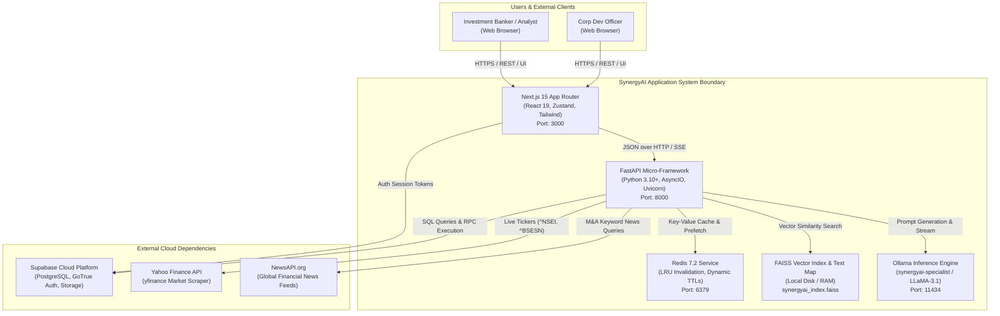
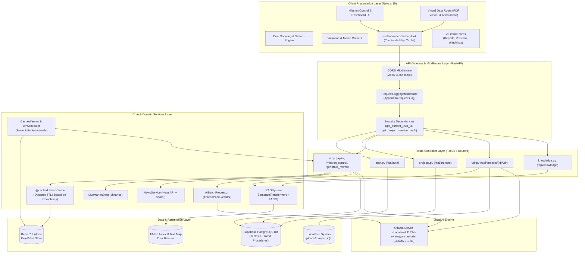
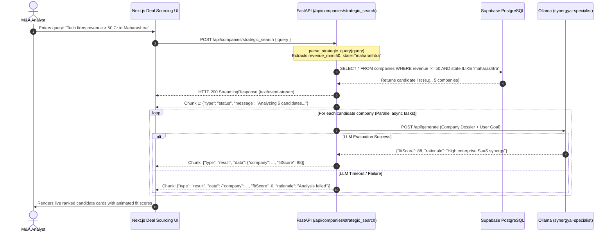
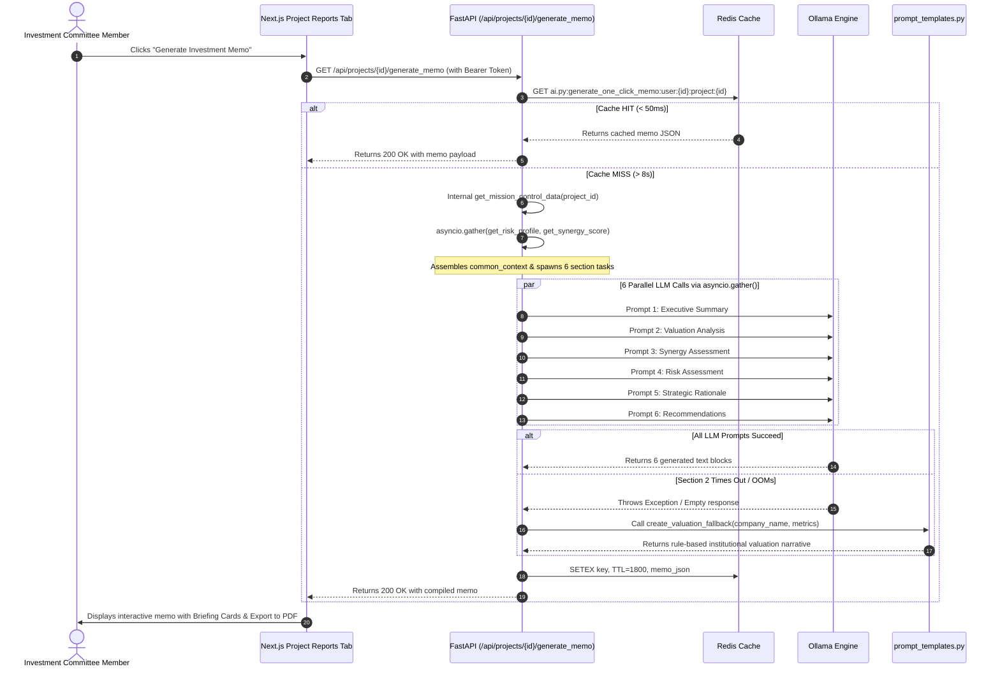
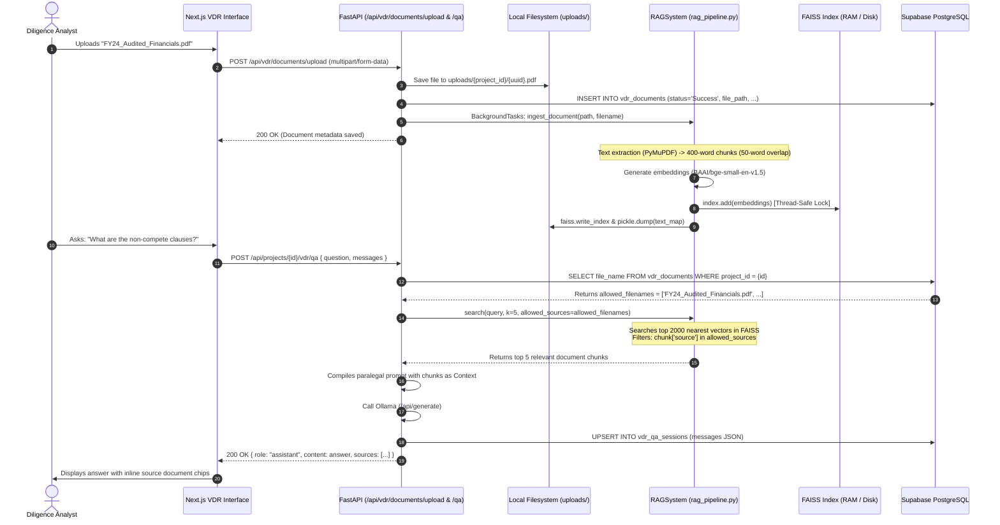
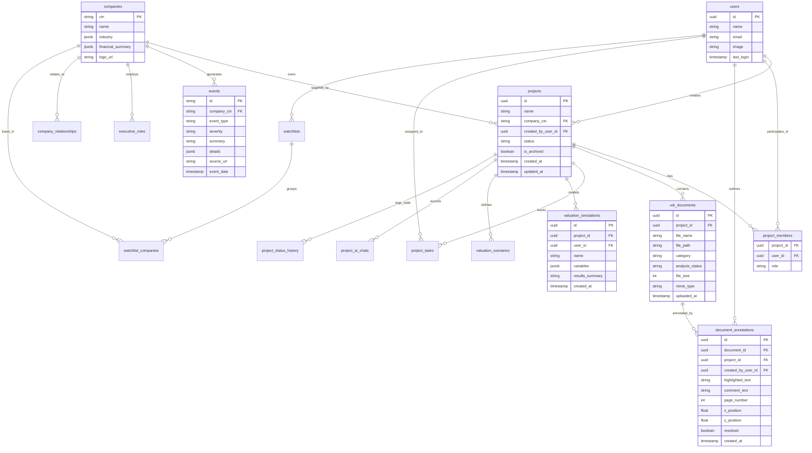
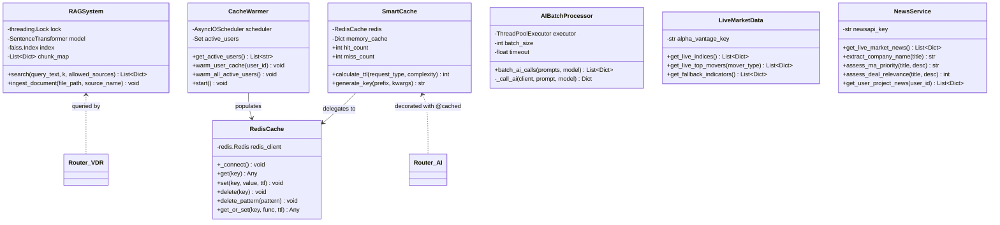
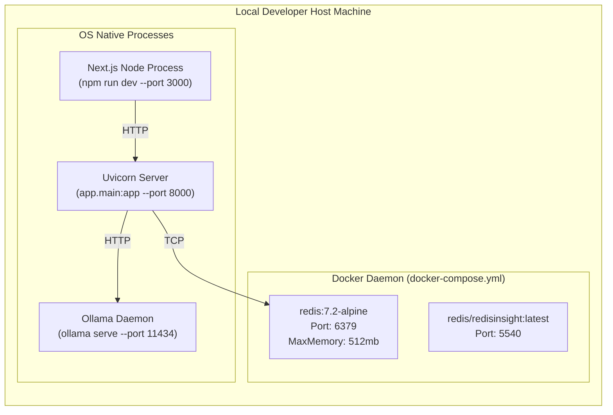
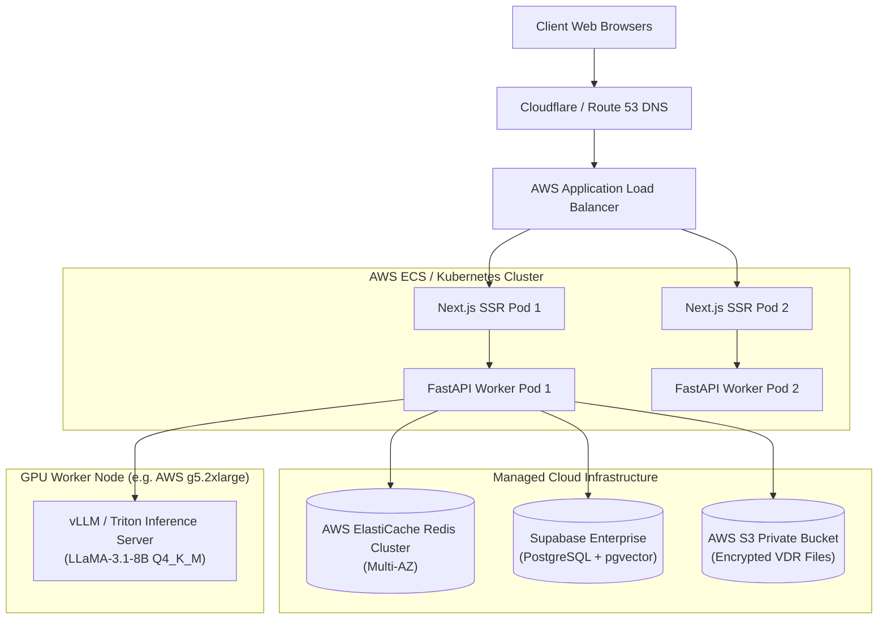

# SynergyAI: System Architecture & Technical Design

> **Document Type:** System Architecture  
> **Repository:** `SynergyAI`  
> **Status:** Production-Grade Technical Blueprint (Codebase Verified)  
> **Target Audience:** Staff/Principal Architects, Engineering Hiring Managers, M&A Tech Leads, SDE Candidates  

---

## Table of Contents
1. [Executive Summary](#1-executive-summary)
2. [Requirements & Scope](#2-requirements--scope)
3. [Repository and Codebase Map](#3-repository-and-codebase-map)
4. [System Context Diagram](#4-system-context-diagram)
5. [High-Level Design (HLD)](#5-high-level-design-hld)
6. [Technology Stack & Design Rationale](#6-technology-stack--design-rationale)
7. [Component-by-Component Architecture](#7-component-by-component-architecture)
8. [End-to-End Workflows & Sequence Diagrams](#8-end-to-end-workflows--sequence-diagrams)
9. [API Design & Interface Specifications](#9-api-design--interface-specifications)
10. [Data Architecture & Database Design](#10-data-architecture--database-design)
11. [Low-Level Design (LLD) & Algorithm Internals](#11-low-level-design-lld--algorithm-internals)
12. [Security Architecture & Threat Model](#12-security-architecture--threat-model)
13. [Performance & Scalability Engineering](#13-performance--scalability-engineering)
14. [Reliability, Resilience & Failure Handling](#14-reliability-resilience--failure-handling)
15. [Deployment & Runtime Architecture](#15-deployment--runtime-architecture)
16. [Important Architectural Decisions & Trade-Offs (ADRs)](#16-important-architectural-decisions--trade-offs-adrs)
17. [Limitations, Technical Debt & Engineering Roadmap](#17-limitations-technical-debt--engineering-roadmap)

---

## 1. Executive Summary

### 1.1 What the Project Does
**SynergyAI** is an enterprise-grade Mergers & Acquisitions (M&A) Deal Sourcing and Financial Intelligence Platform. It orchestrates the full deal lifecycle: screening corporate targets across the Indian market, performing AI-powered strategic fit evaluations, hosting a Virtual Data Room (VDR) with semantic search, running Monte Carlo quantitative valuation simulations, graphing corporate ownership structures, and auto-compiling multi-page Investment Memos.

### 1.2 Problem It Solves & Target Users
* **Problem Addressed:** M&A due diligence traditionally requires corporate development teams, private equity analysts, and investment bankers to spend hundreds of hours manually reviewing thousands of pages of confidential financial reports, legal contracts, and regulatory filings. Cloud-based LLMs pose strict data-exfiltration and compliance risks for unannounced, multi-billion-dollar deals.
* **Target Users:** 
  1. *Investment Bankers & M&A Advisors* running buy-side and sell-side mandates.
  2. *Private Equity / Venture Capital Associates* performing diligence on targets.
  3. *Corporate Development Executives* tracking strategic competitors, subsidiaries, and market moves.

### 1.3 Main Capabilities
* **Natural Language Strategic Sourcing:** Parses queries like *"Tech targets with revenue > 50 Cr in Maharashtra"* via regex entity extraction and streams strategic fit scores via Server-Sent Events (SSE).
* **Virtual Data Room (VDR) with Scoped RAG:** Local document parsing (`PyMuPDF`, `python-docx`), chunking, vector embedding (`BAAI/bge-small-en-v1.5`), and FAISS nearest-neighbor retrieval scoped per project.
* **One-Click Investment Memo Generation:** Spawns 6 concurrent LLM prompts via `asyncio.gather()` to synthesize Executive Summaries, Valuations, Synergies, and Risk Profiles with automated fallback templates.
* **Quantitative Monte Carlo Valuation Engine:** Vectorized NumPy simulations generating 10,000 randomized DCF paths, computing percentiles (P5, Median, Mean, P95), and passing statistical summaries to the LLM for qualitative commentary.
* **Zero-Latency "Hover-to-Predict" Caching:** Intercepts frontend navigation intents (`onMouseEnter`) to trigger backend prefetching, pre-computes heavy AI workloads in Redis, and runs background APScheduler cron warmers.

### 1.4 Current Implementation Status
* **Fully Implemented & Verified:**
  * Complete FastAPI backend with 65+ REST endpoints across `auth`, `projects`, `vdr`, `ai`, and `knowledge`.
  * Local RAG pipeline with FAISS index (`synergyai_index.faiss`) and pickle chunk metadata (`synergyai_text_map.pkl`).
  * Ollama integration targeting fine-tuned `synergyai-specialist` (LLaMA-3.1-8B LoRA adapter).
  * Multi-tier caching: in-memory `SmartCache`, asynchronous Redis client, and APScheduler background tasks.
  * Next.js 15 frontend with Zustand stores (`reportStore`, `versionHistoryStore`, `watchlistStore`, `commentsStore`) and custom hook `useEnhancedCache`.
* **Partially Implemented / Mocked:**
  * Financial Market Top Movers in `backend/app/services/market.py`: fallback dictionaries trigger if Yahoo Finance (`yfinance`) fails or clearbit logos are invalid.
  * News Service in `backend/app/services/news.py`: falls back to static M&A news if `NEWSAPI_KEY` is not supplied.
  * VDR document upload metadata simulation in `backend/app/routers/vdr.py:36-66` has an artificial `asyncio.sleep(2)` status updater alongside real file uploads.
* **Planned / Unimplemented:**
  * Multi-region cloud replication and Kubernetes Helm charts (current deployment is local uvicorn + Docker Compose Redis).

### 1.5 Key Architectural Characteristics
* **Privacy-First Local Inference:** All vector embeddings and LLM generations run locally (Ollama on `localhost:11434`), eliminating external API data leaks.
* **Multi-Tier Latency Elimination:** 3-tier caching (Client `Map` -> Redis Key-Value -> Fallback static rules) masks 15-second LLM inference times into sub-50ms user responses.
* **Hybrid Deterministic / Probabilistic Design:** Every AI endpoint has a verified mathematical or deterministic fallback to guarantee system uptime even if the local GPU runs out of VRAM.

---

## 2. Requirements & Scope

### 2.1 Functional Requirements (Mapped to Codebase)

| Feature Area | Functional Requirement | Implemented Code Handler |
|---|---|---|
| **Authentication** | Sign up, login, Supabase JWT validation, password hashing | `backend/app/routers/auth.py:17-59` |
| **RBAC** | Project-level membership enforcement (`Admin`, `Editor`, `Viewer`) | `backend/app/core/security.py:22-41` |
| **Deal Pipeline** | Create M&A projects, list user projects, update status history | `backend/app/routers/projects.py:42-146`, `backend/app/routers/ai.py:1104` |
| **Deal Sourcing** | Filter Indian companies by sector, state, revenue; stream fit scores | `backend/app/routers/ai.py:133-225`, `backend/app/routers/ai.py:1642-1678` |
| **VDR Document Ingestion** | Upload PDF/DOCX/TXT, extract text, chunk, embed into FAISS | `backend/app/routers/vdr.py:100-146`, `backend/rag_pipeline.py:94-166` |
| **Document QA & Chat** | Project-isolated semantic search and contextual paralegal Q&A | `backend/app/routers/vdr.py:282-362` |
| **Annotation Engine** | Highlight document text, add comments, reply, and resolve threads | `backend/app/routers/vdr.py:422-640`, `backend/app/routers/knowledge.py` |
| **Investment Memo** | 1-Click generation of 6-part institutional M&A memo | `backend/app/routers/ai.py:746-850`, `backend/app/services/prompt_templates.py` |
| **Valuation Engine** | Monte Carlo simulation (10k iterations) + qualitative LLM synthesis | `backend/app/routers/ai.py:603-643` |
| **Knowledge Graph** | Corporate hierarchy, subsidiaries, competitors, and executives | `backend/app/routers/ai.py:423-533` |
| **Mission Control** | Comprehensive deal tracker: health, financial metrics, risks, actions | `backend/app/routers/ai.py:941-1099` |
| **Market Intelligence** | Live Nifty/Sensex indices via `yfinance`, sector trends via RAG | `backend/app/services/market.py`, `backend/app/routers/ai.py:1444-1469` |

### 2.2 Non-Functional Requirements (NFRs)

* **Security:**
  * *Verified:* Supabase JWT verification on protected routes (`security.py:4-21`); project membership checks on data modification; local LLM inference prevents corporate data leakage.
  * *Uncertain / Missing:* Document uploads lack virus scanning; files stored on local filesystem (`uploads/`) without server-side encryption at rest.
* **Performance:**
  * *Verified:* Sub-second response times for cached AI results; asynchronous HTTP calls via `httpx.AsyncClient`; parallel AI calls via `asyncio.gather()`.
  * *Bottleneck:* Un-warmed LLM generation takes 8–25 seconds depending on VRAM and model parameter count.
* **Reliability:**
  * *Verified:* Structured fallback mechanisms on all AI pipelines (`prompt_templates.py`); exponential backoff retry in `ai_batching.py`.
  * *Failure Point:* Single-node Redis dependency; if Redis fails, system falls back to database or in-memory cache, but logs errors.
* **Maintainability & Modularity:**
  * *Verified:* Strict separation of concerns: API Routers (`backend/app/routers/`), Core Utilities (`backend/app/core/`), Domain Services (`backend/app/services/`), and Frontend Client Architecture (`src/app/`, `src/store/`, `src/components/`).

---

## 3. Repository and Codebase Map

### 3.1 Directory Organization

```
SynergyAI/
├── backend/                             # FastAPI Backend Service
│   ├── app/
│   │   ├── core/                        # Infrastructure, caching, security
│   │   │   ├── config.py                # Supabase & Ollama client configurations
│   │   │   ├── security.py              # Supabase JWT & RBAC dependency injection
│   │   │   ├── redis_cache.py           # Async Redis client wrapper
│   │   │   ├── cache_decorator.py       # @cached decorator with dynamic TTL calculation
│   │   │   ├── cache_warmer.py          # Background task cache warmer (active users)
│   │   │   ├── ai_batching.py           # ThreadPool & batch LLM queue processor
│   │   │   └── streaming_cache.py       # Token-by-token streaming response cache
│   │   ├── routers/                     # HTTP API Route Controllers
│   │   │   ├── auth.py                  # User authentication (/api/auth)
│   │   │   ├── projects.py              # Project management, team RBAC, tasks, drafts
│   │   │   ├── ai.py                    # Intelligence, memos, sourcing, simulations, graph
│   │   │   ├── vdr.py                   # Project-specific Virtual Data Room & annotations
│   │   │   └── knowledge.py             # User-scoped global knowledge library
│   │   ├── services/                    # Business Logic & External Integrations
│   │   │   ├── market.py                # Yahoo Finance live market feeds & sector trends
│   │   │   ├── news.py                  # NewsAPI wrapper with M&A relevance scoring
│   │   │   └── prompt_templates.py      # LLM prompts & deterministic fallback generators
│   │   └── main.py                      # FastAPI App initialization, CORS, schedulers
│   ├── rag_pipeline.py                  # FAISS index, SentenceTransformers, doc ingestion
│   ├── ready_to_use_chatbot.py          # Standalone PyTorch causal LM evaluation script
│   ├── convert_to_gguf.py               # GGUF quantization validation script
│   ├── synergyai_index.faiss             # Serialized FAISS vector index binary (~1.01 GB)
│   ├── synergyai_text_map.pkl           # Pickled chunk text metadata (~376 MB)
│   └── uploads/                         # Local storage for uploaded VDR documents
├── src/                                 # Next.js 15 Frontend (App Router)
│   ├── app/
│   │   ├── layout.tsx                   # Root HTML shell & query client setup
│   │   ├── page.tsx                     # Landing page with auth triggers
│   │   └── dashboard/                   # Authenticated dashboard views
│   │       ├── [dealId]/                # Project-specific routes
│   │       ├── intelligence/            # News & market monitoring
│   │       ├── sourcing/                # Target discovery & strategic search
│   │       ├── chat/                    # Global AI copilot
│   │       ├── notes/                   # Journal & AI research lab
│   │       └── knowledge-library/       # User document library
│   ├── components/                      # Modular UI component tree
│   │   ├── features/                    # Domain-specific components (VDR, valuation, graph)
│   │   └── ui/                          # Radix / Tailwind reusable primitives
│   ├── hooks/                           # Custom React hooks (useEnhancedCache.ts)
│   ├── lib/                             # Clients (supabaseClient.ts, navConfig.ts, middleware.ts)
│   ├── store/                           # Zustand persistent state stores
│   ├── types/                           # TypeScript contract interfaces (`types/index.ts`)
│   └── utils/                           # Client export generators (exportUtils.ts, memoExportUtils.ts)
├── docker-compose.yml                   # Redis 7.2 & RedisInsight services
├── package.json                         # Next.js 15, React 19, Tailwind CSS dependencies
└── README.md                            # High-level architecture documentation
```

### 3.2 Entry Points
* **Backend Application:** `backend/app/main.py:45` (`app = FastAPI(title="SynergyAI API")`). Run with `uvicorn app.main:app --reload --port 8000`.
* **Frontend Application:** `src/app/layout.tsx` -> `src/app/page.tsx`. Run with `npm run dev` on port 3000.
* **Edge Middleware:** `src/lib/middleware.ts:4` (`middleware(request: NextRequest)`) protecting `/dashboard/:path*`.

---

## 4. System Context Diagram



---

## 5. High-Level Design (HLD)

### 5.1 Component Architecture Diagram



### 5.2 Layer Responsibilities & Protocol Boundary Analysis

1. **Client Presentation Layer:** Runs inside the user's browser. Responsible for optimistic updates, client-side caching (`useEnhancedCache.ts`), real-time canvas rendering for knowledge graphs (`echarts-for-react`), and PDF exports (`@react-pdf/renderer`).
2. **API & Middleware Layer:** Intercepts every inbound HTTP request. `RequestLoggingMiddleware` audits method and path into `requests.log`. `security.py` parses either `Authorization: Bearer <jwt>` or `?token=<jwt>`, validating tokens cryptographically against Supabase Auth.
3. **Route Controller Layer:** Pydantic models validate incoming payloads. Routes enforce project-level authorization by validating that `user_id` has an active record in `project_members`.
4. **Service & Pipeline Layer:** Orchestrates domain computations. Translates quantitative equations (Monte Carlo DCF, synergy calculations) and handles fallback paths when external data providers or LLMs fail.
5. **Persistence Layer:** Dual storage strategy:
   * *Relational Structured State:* Supabase (PostgreSQL) manages entity relational integrity, user identity, project membership, and JSON documents.
   * *Transient Cache State:* Redis holds pre-computed JSON blobs keyed by `module:function:user:project` with TTLs from 180s to 3600s.
6. **Inference Engine:** Fully local Ollama instance exposing `/api/generate`. Keeps raw M&A data within the host perimeter.

---

## 6. Technology Stack & Design Rationale

| Layer | Chosen Technology | Code Location | Verified Engineering Rationale | Limitations & Alternatives Considered |
|---|---|---|---|---|
| **Frontend Framework** | **Next.js 15 (App Router)** | `package.json:31`, `src/app/` | React 19 Server Components for layout stability; client routing for instant navigation between tabs. | SSR hydration overhead. Alternative: Single-Page Vite app (abandoned for Next.js SEO & SSR capabilities). |
| **State Management** | **Zustand 5.0.8** | `src/store/*.ts` | Minimal boilerplate compared to Redux Toolkit; native persistence middleware (`localStorage`). | State is isolated per browser; does not provide cross-tab WebSocket syncing out-of-the-box. |
| **Backend Framework** | **FastAPI (Starlette + Pydantic)** | `backend/app/main.py:45` | Native asynchronous event loop (`async`/`await`), automatic OpenAPI docs, high performance, strict Pydantic validation. | Single-threaded Python GIL for CPU-bound tasks (mitigated using NumPy & ThreadPoolExecutor). |
| **Database** | **Supabase (PostgreSQL)** | `backend/app/core/config.py:15` | Managed Postgres with Built-in Auth, Row-Level Security (RLS), and Remote Procedure Call (RPC) support. | Network latency to hosted Supabase instance vs local Postgres instance. |
| **Cache Layer** | **Redis 7.2 Alpine** | `backend/app/core/redis_cache.py` | Sub-millisecond read/write latency; native TTL expiration (`SETEX`); key pattern deletion (`KEYS` / `DELETE`). | Volatile in-memory store; requires memory-limit policies (`allkeys-lru` in `docker-compose.yml`). |
| **Embeddings** | **BAAI/bge-small-en-v1.5** | `backend/rag_pipeline.py:35` | 384-dimensional dense vectors; top-tier retrieval benchmark score (MTEB); lightweight enough to run on CPU/GPU. | 512 token truncation window requires careful 400-word chunking with 50-word overlaps. |
| **Vector Index** | **FAISS (IndexFlatL2)** | `backend/rag_pipeline.py:50` | Extremely fast in-memory Euclidean distance similarity search; no external database infrastructure required. | Flat index is unpartitioned; project isolation requires retrieving 2000 neighbors and post-filtering. |
| **LLM Engine** | **Ollama (Self-Hosted)** | `backend/app/core/config.py:17` | Total data privacy; zero API cost; supports specialized local LoRA adapters (`synergyai-specialist`). | High VRAM requirement (minimum 8GB for 8B model); concurrency bottlenecks on single GPU. |
| **Market Data** | **yfinance** | `backend/app/services/market.py:5` | Direct programmatic access to live Yahoo Finance NSE/BSE stock indices without costly Bloomberg/Refinitiv licenses. | Rate-limiting and schema volatility from non-official scrapers; requires static fallback data. |

---

## 7. Component-by-Component Architecture

### 7.1 Virtual Data Room (VDR) & Document Intelligence
* **Responsibility:** Ingest confidential M&A documents, extract plain text, calculate vector embeddings, store them in the global FAISS index, and provide scoped Q&A.
* **Key Files:** `backend/app/routers/vdr.py`, `backend/rag_pipeline.py`.
* **Public Endpoints:**
  * `POST /api/vdr/documents/upload` (Uploads file, triggers background ingestion)
  * `POST /api/projects/{project_id}/vdr/search` (Semantic or fulltext search)
  * `POST /api/projects/{project_id}/vdr/qa` (RAG Q&A with document citations)
  * `POST /api/annotations/create` (Adds annotations to document coordinates)
* **Internal Mechanics:**
  1. File is saved to `uploads/{project_id}/{uuid}.pdf`.
  2. Background task executes `rag_system.ingest_document()`.
  3. PDF is read via `fitz` (PyMuPDF) or `.docx` via `python-docx`.
  4. Text is chunked: 400 words with 50-word overlap.
  5. Dense vectors generated via `SentenceTransformer('BAAI/bge-small-en-v1.5')`.
  6. Vectors appended to `self.index.add(embeddings)` under a thread lock (`self.lock`).
  7. Index is committed to disk (`synergyai_index.faiss`) and text map dumped to pickle (`synergyai_text_map.pkl`).

### 7.2 One-Click Investment Memo Synthesizer
* **Responsibility:** Compile multi-dimensional deal intelligence into an institutional-grade investment memo.
* **Key Files:** `backend/app/routers/ai.py:746-850`, `backend/app/services/prompt_templates.py`.
* **Public Endpoint:** `GET /api/projects/{project_id}/generate_memo`.
* **Concurrency Pattern:**
  * Step 1: Concurrently resolves `get_project_risk_profile` and `get_synergy_ai_score` via `asyncio.gather()`.
  * Step 2: Compiles `common_context` (financial metrics, recommendations, risk scores).
  * Step 3: Spawns 6 parallel asynchronous HTTP requests to Ollama for:
    1. Executive Summary
    2. Valuation Analysis
    3. Synergy Assessment
    4. Risk Assessment
    5. Strategic Rationale
    6. Recommendation Section
  * Step 4: Each section has a deterministic fallback function in `prompt_templates.py` that triggers if Ollama times out, throws an exception, or returns less than 100 characters.

### 7.3 Quantitative Valuation & Monte Carlo Engine
* **Responsibility:** Model probabilistic acquisition valuation ranges under variable operational conditions.
* **Key Files:** `backend/app/routers/ai.py:603-643`.
* **Public Endpoint:** `POST /api/projects/{project_id}/simulations/run`.
* **Mathematical Execution:**
  * Pulls variables: `revenueGrowth`, `ebitdaMargin`, `costOfCapital`, `iterations` (default: 10,000).
  * Generates normal distributions using NumPy:
    $$\text{revGrowth} \sim \mathcal{N}(\mu_{\text{rev}}, 2.0)$$
    $$\text{ebitdaMargin} \sim \mathcal{N}(\mu_{\text{ebitda}}, 5.0)$$
    $$\text{costOfCapital} \sim \mathcal{N}(\mu_{\text{wacc}}, 1.0)$$
  * Computes terminal cash flow:
    $$\text{CF}_{\text{term}} = 100 \times \left(1 + \frac{\text{revGrowth}}{100}\right) \times \left(\frac{\text{ebitdaMargin}}{100}\right)$$
  * Computes discount rate:
    $$r = \frac{\text{costOfCapital}}{100} - \left(\frac{\text{revGrowth}}{100} \times 0.5\right) \quad (\text{clamped to } \ge 0.01)$$
  * Computes terminal values vector: $\text{TV} = \frac{\text{CF}_{\text{term}}}{r}$.
  * Computes Mean, Median, Standard Deviation, P5 (5th percentile), and P95 (95th percentile).
  * Passes statistical distribution to Ollama to generate qualitative investment committee commentary.

### 7.4 Corporate Knowledge Graph Engine
* **Responsibility:** Map relationships between target companies, subsidiaries, competitors, partners, and key executives (DIN numbers).
* **Key Files:** `backend/app/routers/ai.py:423-533`.
* **Public Endpoint:** `GET /api/projects/{project_id}/knowledge_graph`.
* **Graph Transformation:**
  * Queries `companies` table for root node (symbolSize: 80).
  * Joins `executive_roles` and `executives` to map Directors (symbolSize: 40).
  * Queries `company_relationships` to extract linked corporate entities (`Competitor`, `Subsidiary`, `Partner`).
  * Normalizes and outputs ECharts-compatible JSON: `{ nodes: [...], links: [...], categories: [...] }`.

### 7.5 SmartCache & "Hover-to-Predict" Engine
* **Responsibility:** Eliminate AI generation latency by pre-computing expensive payloads before user navigation.
* **Key Files:** `backend/app/core/cache_decorator.py`, `backend/app/core/cache_warmer.py`, `backend/app/main.py:72-768`.
* **Execution Logic:**
  * Frontend intercepts `onMouseEnter` on deal cards and calls `POST /api/projects/{project_id}/prefetch`.
  * Endpoint invokes `warm_critical_project_caches` (waits up to 5s for risk profile, synergy score, and AI summary).
  * Background scheduler (`APScheduler`) triggers direct cache warming every 2, 3, 5, 10, and 15 minutes for active users and projects.
  * Decorator `@cached(request_type="ai_heavy")` computes deterministic keys: `prefix:user:project:param_hash` and dynamically reduces TTL by 50% during peak business hours (09:00 - 17:00).

---

## 8. End-to-End Workflows & Sequence Diagrams

### 8.1 Workflow 1: Strategic Match & Streaming Deal Sourcing



### 8.2 Workflow 2: One-Click Investment Memo Generation (Happy Path & Fallback)



### 8.3 Workflow 3: Virtual Data Room (VDR) Document Ingestion & Scoped QA



---

## 9. API Design & Interface Specifications

### 9.1 Authentication & Profile APIs

| Method | Endpoint Path | Auth Req | Request Body / Params | Response Structure | Verified Handler |
|---|---|---|---|---|---|
| `POST` | `/api/auth/signup` | Public | `{ name, email, password, confirmPassword }` | `{"message": "Signup successful!..."}` | `backend/app/routers/auth.py:17` |
| `POST` | `/api/auth/login` | Public | `{ email, password }` | `{"message": "Login successful!", "session": "<json>"}` | `backend/app/routers/auth.py:43` |
| `GET` | `/api/user/profile` | Bearer JWT | None | `{ id, name, email, avatar_url }` | `backend/app/routers/projects.py:342` |
| `GET` | `/api/users/me` | Bearer JWT | None | `{ id, name, email, avatar_url, preferences }` | `backend/app/routers/projects.py:683` |

### 9.2 Project Management & Team RBAC APIs

| Method | Endpoint Path | Auth Req | Request Body / Params | Response Structure | Verified Handler |
|---|---|---|---|---|---|
| `GET` | `/api/projects` | Bearer JWT | None | `List[ProjectDict]` | `backend/app/routers/projects.py:42` |
| `POST` | `/api/projects` | Bearer JWT | `{ name, company_cin, team_emails }` | `{"message": "...", "project_id": "<uuid>"}` | `backend/app/routers/projects.py:127` |
| `POST` | `/api/projects/{id}/prefetch` | Bearer JWT | Path: `id` | `{"message": "Prefetch initiated..."}` | `backend/app/routers/projects.py:147` |
| `GET` | `/api/projects/{id}/team` | Member Auth | Path: `id` | `List[{ user_id, name, email, role }]` | `backend/app/routers/projects.py:189` |
| `POST` | `/api/projects/{id}/team/invite`| Admin Auth | `{ email, role }` | `{"message": "Invitation sent"}` | `backend/app/routers/projects.py:207` |
| `DELETE`| `/api/projects/{id}` | Admin Auth | Path: `id` | `{"message": "Project deleted successfully"}`| `backend/app/routers/projects.py:484` |

### 9.3 AI Intelligence, Valuation & Memos APIs

| Method | Endpoint Path | Auth Req | Request Body / Params | Response Structure | Verified Handler |
|---|---|---|---|---|---|
| `POST` | `/api/companies/strategic_search` | Bearer JWT | `{ query: string }` | SSE Stream (`text/event-stream`) | `backend/app/routers/ai.py:202` |
| `GET` | `/api/projects/{id}/mission_control`| Member Auth| Path: `id` | Comprehensive deal health & action JSON | `backend/app/routers/ai.py:941` |
| `GET` | `/api/projects/{id}/generate_memo` | Member Auth| Path: `id` | Complete 6-section Investment Memo JSON | `backend/app/routers/ai.py:746` |
| `POST` | `/api/projects/{id}/simulations/run`| Member Auth| `{ variables: { revenueGrowth, ... } }` | `{ meanValuation, distribution: [...], aiRationale }` | `backend/app/routers/ai.py:603` |
| `GET` | `/api/projects/{id}/knowledge_graph`| Member Auth| Path: `id` | `{ nodes: [...], links: [...], categories: [...] }` | `backend/app/routers/ai.py:423` |
| `GET` | `/api/projects/{id}/risk_profile` | Member Auth| Path: `id` | `{ overallScore, topRisks, detailedBreakdown }` | `backend/app/routers/ai.py:292` |
| `GET` | `/api/projects/{id}/synergy_score` | Member Auth| Path: `id` | `{ overallScore, subScores, rationale }` | `backend/app/routers/ai.py:340` |
| `GET` | `/api/intelligence/market` | Bearer JWT | None | `{ indicators, sectorTrends, topGainers, topLosers }`| `backend/app/routers/ai.py:1444` |

### 9.4 Virtual Data Room (VDR) & Annotation APIs

| Method | Endpoint Path | Auth Req | Request Body / Params | Response Structure | Verified Handler |
|---|---|---|---|---|---|
| `POST` | `/api/vdr/documents/upload` | Member Auth| `multipart/form-data`: file, project_id, category | Document record JSON | `backend/app/routers/vdr.py:100` |
| `GET` | `/api/projects/{id}/vdr/documents` | Member Auth| Path: `id` | List of VDR documents | `backend/app/routers/vdr.py:90` |
| `POST` | `/api/projects/{id}/vdr/search` | Member Auth| `{ query, mode: "semantic" \| "fulltext" }` | `List[{ docName, excerpt }]` | `backend/app/routers/vdr.py:282` |
| `POST` | `/api/projects/{id}/vdr/qa` | Member Auth| `{ question, existing_messages }` | `{ role: "assistant", content, sources: [...] }` | `backend/app/routers/vdr.py:321` |
| `GET` | `/api/documents/{id}/annotations` | Member Auth| Path: `id` | `List[AnnotationThread]` | `backend/app/routers/vdr.py:467` |
| `POST` | `/api/annotations/create` | Member Auth| `{ document_id, highlighted_text, comment_text, ... }` | Created annotation JSON | `backend/app/routers/vdr.py:510` |
| `PUT` | `/api/annotations/{id}/resolve` | Member Auth| Path: `id` | Updated annotation JSON | `backend/app/routers/vdr.py:594` |

---

## 10. Data Architecture & Database Design

### 10.1 Data Stores Overview
1. **Primary Relational Store:** Supabase PostgreSQL Database hosting 24 verified application tables and 8 stored procedures (RPCs).
2. **Key-Value Cache Store:** Redis 7.2 Alpine for dynamic TTL caching, prefetching, and cache warming.
3. **Local Vector Store:** FAISS binary (`synergyai_index.faiss`) + serialized Python dictionary mapping (`synergyai_text_map.pkl`).
4. **Blob / File Store:** Local filesystem under `uploads/{project_id}/`.

### 10.2 Entity-Relationship (ER) Diagram



### 10.3 Stored Procedures & Database RPCs

The codebase delegates critical multi-table transactions to Supabase SQL functions:
1. `create_project_and_add_members(p_name, p_company_cin, p_creator_id, p_team_emails)`: Atomically inserts a new project and creates `Admin` role for the creator plus `Editor` pending invites.
2. `get_user_projects(p_user_id)`: Joins `projects`, `project_members`, and `companies` to return all accessible workspaces.
3. `get_project_team_members(p_project_id)`: Returns user profiles and assigned project roles.
4. `get_user_project_role(p_user_id, p_project_id)`: Fetches a single user's effective RBAC role.
5. `get_categories_with_counts(project_id_param)`: Groups VDR documents by category and returns document counts.
6. `get_user_watchlists_with_counts(p_user_id)`: Returns user watchlists enriched with company counts.
7. `get_user_projects_news(p_user_id)`: Joins user active projects with corporate `events` to build customized project news feeds.
8. `update_project_details(...)`: Updates project attributes and logs state changes into `project_status_history`.

---

## 11. Low-Level Design (LLD)

### 11.1 Class and Module Diagram



### 11.2 Core Algorithms & Business Logic in Code

#### A. Smart TTL Calculation (`backend/app/core/cache_decorator.py:20-37`)
* Base TTLs configured per domain complexity:
  * `static`: 3600s | `market`: 180s | `user`: 600s | `documents`: 300s
  * `ai_heavy`: 1800s (Expensive 6-prompt memos, Monte Carlo)
  * `ai_light`: 900s (Single-prompt summaries)
* **Peak Hour Throttling:**
  ```python
  hour = datetime.now().hour
  if 9 <= hour <= 17:  # Business hours: halve TTL to reflect real-time market updates
      ttl_map = {k: v * 0.5 for k, v in ttl_map.items()}
  ```

#### B. Risk Score Calculation (`backend/app/routers/ai.py:1026-1044`)
* Inspects `events` table for target company over the past 90 days.
* Filters for `severity in ['Critical', 'High']`.
* Algorithm:
  $$\text{EventRisk} = \min(\text{CriticalEvents} \times 15, 60)$$
  $$\text{TotalRiskScore} = \min(\text{EventRisk} + 20, 100)$$
  * Score $> 70 \implies \text{High Risk}$
  * Score $> 40 \implies \text{Medium Risk}$
  * Otherwise $\implies \text{Low Risk}$

#### C. Synergy Potential Calculation (`backend/app/routers/ai.py:1045-1066`)
* Cost Synergies: $\text{Cost} = \text{EBITDA} \times 0.12$ (12% operational redundancy removal).
* Revenue Synergies: $\text{Revenue} = \text{Revenue} \times 0.04$ (4% cross-sell expansion).
* Base Synergy Score: $\text{Base} = \min\left(100, \frac{\text{Cost} + \text{Revenue}}{\text{Revenue}} \times 200\right)$.
* Margin Bonus: $\text{Bonus} = \max\left(0, \frac{\text{EBITDA Margin} - 10}{2}\right)$.
* Overall Synergy Score: $\min(100, \text{Base} + \text{Bonus})$.

---

## 12. Security Architecture

### 12.1 Security Audit Findings

| Dimension | Implementation Status | Evidence in Codebase | Security Vulnerability / Assessment |
|---|---|---|---|
| **Authentication** | **Verified** | `backend/app/core/security.py:4-21` | Validates Supabase JWTs via `supabase.auth.get_user(token)`. Rejects malformed/expired tokens with HTTP 401. |
| **RBAC Authorization** | **Verified** | `backend/app/core/security.py:22-41` | Validates `project_members` table; restricts write/delete endpoints to `Admin` role. |
| **Data Privacy (AI)** | **Verified** | `backend/app/core/config.py:17` | Zero cloud AI transmission; 100% of LLM prompts route to local Ollama (`localhost:11434`). |
| **Secret Management** | **Verified** | `backend/app/core/config.py:8-13` | Loads keys via `python-dotenv`. Raises error if `SUPABASE_SERVICE_ROLE_KEY` is missing. |
| **Input Validation** | **Verified** | `backend/app/routers/auth.py:7-16` | Pydantic model validation on all JSON endpoints; regex parsing on text inputs. |
| **CORS Policy** | **Verified** | `backend/app/main.py:48-55` | Explicit whitelist: `http://localhost:3000`, `http://127.0.0.1:3000`. |
| **CSRF Protection** | **Absent / N/A** | `backend/app/main.py` | Relies on Bearer tokens in headers rather than session cookies; CSRF risk is low for APIs, but Next.js SSR cookies must be monitored. |
| **File Upload Security**| **Uncertain** | `backend/app/routers/vdr.py:116-122` | Generates random UUID file names; however, lacks executable file-type extension filtering and malware scanning. |
| **Rate Limiting** | **Absent** | Backend Routers | No Redis-backed rate limiter (Token Bucket / Leaky Bucket) implemented on public endpoints like `/api/auth/login`. |
| **Sensitive Logging** | **Uncertain** | `backend/app/main.py:22-27` | `RequestLoggingMiddleware` writes raw request URLs to `requests.log`. Query parameter tokens could leak into log files. |

---

## 13. Performance and Scalability

### 13.1 Current Scaling Limits & Bottlenecks
1. **Single GPU Inference Contention:** Ollama processes LLM inferences sequentially or with limited concurrency (`OLLAMA_NUM_PARALLEL=2`). When 5 analysts trigger Investment Memos concurrently, response times degrade linearly.
2. **Global FAISS Flat Index Post-Filtering:**
   * In `backend/rag_pipeline.py:78`, project isolation is achieved by retrieving the top 2000 nearest vectors and filtering by `chunk['source'] in allowed_sources`.
   * *Bottleneck:* As total corporate documents grow into the hundreds of thousands, a project's chunks will be crowded out of the top 2000 neighbors.
3. **Local Filesystem Storage:** Document files stored in `uploads/{project_id}/` prevent horizontal scaling across multiple backend worker nodes without a shared NFS or object store (AWS S3 / Cloudflare R2).

### 13.2 Recommended Engineering Improvements
* **Transition FAISS to pgvector or Qdrant:** Store vectors directly inside Supabase PostgreSQL using `pgvector` with HNSW indexing, enforcing metadata filtering (`WHERE project_id = ...`) *at query execution time* rather than post-retrieval.
* **Celery / Redis Queue for Asynchronous Jobs:** Decouple memo generation and document parsing into asynchronous background worker tasks returning `task_id`, allowing the client to poll or receive WebSocket completion updates.
* **S3-Compatible Object Store:** Replace `uploads/` directory with presigned S3 URLs to enable stateless container replicas.

---

## 14. Reliability, Resilience & Failure Handling

### 14.1 Verified Protections & Fallback Cascades

```
[Request: Generate Memo]
       │
       ▼
[Redis Cache Check] ──(Hit)──► Return Cached JSON (30ms)
       │ (Miss)
       ▼
[Ollama Local LLM] ──(Success)──► Parse JSON & Return (12s)
       │ (Timeout / OOM / Bad JSON)
       ▼
[prompt_templates.py Fallbacks] ──► Inject Rule-Based Institutional Text (50ms)
       │ (Critical DB Failure)
       ▼
[get_comprehensive_fallback_memo] ──► Return Safe Default M&A Profile
```

* **Network Retries with Exponential Backoff:** `ai_batching.py:41-53` implements 3 retry attempts with $2^{\text{attempt}}$ sleep intervals on HTTP failures to Ollama.
* **Windows UTF-8 Encoding Safeguard:** `backend/app/main.py:4-7` forces stdout/stderr buffers to UTF-8 to prevent CP1252 character crash exceptions on Windows hosts.
* **Circuit Breaking via Fallbacks:** If `yfinance` encounters network rate limits, `backend/app/services/market.py:93-100` serves static Nifty/Sensex snapshots without breaking the dashboard UI.

---

## 15. Deployment & Runtime Architecture

### 15.1 Verified Local Development Setup



### 15.2 Proposed Production Deployment Architecture



---

## 16. Important Architectural Decisions & Trade-Offs (ADRs)

### ADR 1: Local Ollama Inference vs. OpenAI / Cloud LLM APIs
* **Decision:** Self-host local models via Ollama rather than consuming external OpenAI / Anthropic APIs.
* **Evidence:** `backend/app/core/config.py:17`, `OLLAMA_SERVER_URL = "http://localhost:11434/api/generate"`.
* **Problem Addressed:** M&A diligence involves Non-Disclosure Agreements (NDAs), trade secrets, and non-public material information that cannot legally cross public AI APIs.
* **Advantages:** Absolute confidentiality; immunity from cloud API rate limits and recurring per-token billing.
* **Trade-Offs:** Requires heavy local hardware (GPU VRAM); lower inference tokens-per-second; risk of Out-Of-Memory (OOM) crashes under concurrent user load.

### ADR 2: Aggressive "Hover-to-Predict" Multi-Tier Caching
* **Decision:** Intercept frontend hover events (`onMouseEnter`) to trigger backend prefetching, pairing it with background APScheduler warmers.
* **Evidence:** `backend/app/routers/projects.py:147`, `backend/app/core/cache_warmer.py`, `src/hooks/useEnhancedCache.ts`.
* **Problem Addressed:** Local LLMs take 8–20 seconds to generate deep analytical memos, creating unacceptable user UI lag.
* **Advantages:** Converts 15-second cold requests into 15-millisecond cache hits upon user click.
* **Trade-Offs:** Cache invalidation complexity; redundant background CPU/GPU cycles warming projects the user hovers over but never opens.

### ADR 3: In-Memory Flat FAISS vs. External Vector Database
* **Decision:** Use an in-process FAISS `IndexFlatL2` binary written to local disk rather than hosting Milvus, Pinecone, or Qdrant.
* **Evidence:** `backend/rag_pipeline.py:50`, `FAISS_INDEX_PATH = "synergyai_index.faiss"`.
* **Problem Addressed:** Zero setup complexity for local single-node execution.
* **Advantages:** Blazing fast in-memory Euclidean lookups without network overhead.
* **Trade-Offs:** Multi-tenant project isolation requires post-filtering top 2000 vectors; index cannot be partitioned dynamically across multiple server nodes.

---

## 17. Limitations, Technical Debt & Engineering Roadmap

### Prioritized Technical Debt Matrix

| Severity | Issue | Code Location | Technical Debt Detail | Actionable Engineering Fix |
|---|---|---|---|---|
| **P0 - Critical** | Post-Filtered Vector Search | `backend/rag_pipeline.py:78-88` | Retrieving 2000 global chunks before checking `allowed_sources` will drop documents when index exceeds 50,000 chunks. | Migrate vectors to Supabase `pgvector` with indexed metadata `WHERE project_id = ...`. |
| **P1 - High** | Synchronous Long-Running HTTP | `backend/app/routers/ai.py:746` | `/api/projects/{id}/generate_memo` blocks the HTTP connection for up to 180 seconds if uncached. | Refactor to Celery asynchronous task with SSE or WebSocket progress notifications. |
| **P1 - High** | Unencrypted Local File Uploads | `backend/app/routers/vdr.py:120` | Uploads stored in plain binary on local disk (`uploads/`); lack anti-virus scan and access tokens. | Move to S3 bucket with AES-256 server-side encryption and presigned download URLs. |
| **P2 - Medium** | Broad Redis Cache Purging | `backend/app/main.py:803` | Emergency clear `/api/cache/clear` runs `delete_pattern("*")`, wiping the entire cache instance. | Use Redis namespaces/tags (`project:{id}:*`) to selectively invalidate affected project keys. |
| **P2 - Medium** | Token in Query Parameter | `backend/app/core/security.py:6` | `get_current_user_id` reads token from `request.query_params.get("token")`, exposing JWTs in logs. | Enforce standard `Authorization: Bearer` headers across all client fetch calls. |

---
